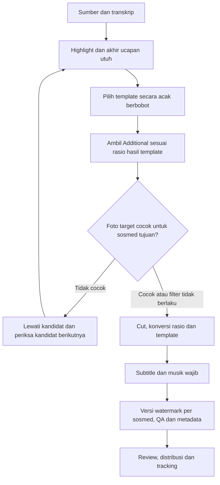

# Campaign Additional

Additional adalah aturan tambahan campaign yang berlaku menurut **rasio hasil template**, **sosmed tujuan**, dan **pilihan template**. Pengaturan ikut snapshot job; perubahan campaign berlaku untuk job baru.

## Alur pengguna

1. Buka **Campaign → edit → Additional → Tambah**.
2. Pilih **Watermark** atau **Hanya clip wajah**.
3. Pilih satu atau beberapa rasio hasil: 9:16, 1:1, 16:9, atau rasio custom dari template impor.
4. Pilih **TikTok**, **IG**, atau keduanya.
5. Pilih aturan template: **Semua template**, **Hanya digunakan pada template**, atau **Tidak digunakan pada template**, kemudian pilih template yang dimaksud.
6. Unggah PNG/JPG/JPEG/WebP. Untuk watermark, pilih beberapa gambar sekaligus atau tekan **Tambah gambar** lagi, lalu atur setiap gambar langsung pada kanvas. Simpan campaign setelah selesai.

Additional dapat dinonaktifkan atau dihapus. Gambar disalin ke `campaign_assets/additional/` dan diikat dengan SHA-256, sehingga file asli dapat dipindah sesudah unggahan berhasil. Gambar Additional tidak menjadi scene sisipan. Draft tanpa gambar dapat disimpan; produksi ditahan jika aturan yang berlaku belum lengkap. Aturan dengan rasio yang belum dipakai template aktif menghasilkan peringatan dan belum diterapkan.

### Watermark

- Satu Additional watermark menampung maksimal 24 gambar. Setiap gambar punya ID, posisi, ukuran, dan hash sendiri; gambar yang sama boleh dipakai pada dua posisi.
- Upload gambar dengan transparansi jika diperlukan. Gambar baru ditambahkan ke daftar tanpa mengganti gambar yang sudah ada. Dalam satu pilihan file, gambar valid tetap ditambahkan dan nama file yang ditolak ditampilkan.
- Ikon sampah di kiri atas setiap gambar menghapus gambar tersebut. Daftar nama di bawah kanvas juga menyediakan hapus untuk gambar yang saling menutupi atau gagal dimuat. Menghapus gambar terakhir tetap mempertahankan Additional sebagai draft; produksi memerlukan gambar atau penonaktifan aturan itu.
- Hapus gambar mengubah konfigurasi campaign sesudah disimpan. Salinan yang masih dibutuhkan snapshot campaign/job lama tetap tersedia.
- Pilih rasio preview, geser gambar untuk posisi dan tarik pegangan sudut untuk memperbesar/perkecil. Tidak ada input angka posisi, ukuran, atau opasitas.
- Opasitas selalu 100%. Transparansi bawaan PNG/WebP tetap dipertahankan.
- Keyboard: panah untuk memindahkan, `+`/`-` untuk mengubah ukuran, Shift untuk langkah lebih besar.
- Kanvas 9:16 memakai gambar **Space Tiktok.png** yang diberikan pengguna. Ini panduan penempatan untuk TikTok, bukan klaim panduan IG, dan tidak ikut dirender. Rasio lain memakai kanvas sesuai rasio tanpa panduan TikTok 9:16.
- Posisi 0% berada di kiri/atas; 100% di kanan/bawah. Posisi dihitung terhadap ruang kosong yang tersisa sesudah ukuran gambar ditentukan, sehingga gambar tetap di dalam frame.
- Lebar berupa persentase canvas hasil. Proporsi gambar dipertahankan; gambar terlalu tinggi diperkecil agar muat.
- Gambar diterapkan menurut urutan Additional, kemudian urutan unggahan dalam item tersebut. Watermark campaign merupakan lapisan seluruh video final, termasuk penutup. Watermark global di Settings masih berlaku sesuai pengaturannya sendiri.
- Versi sosmed dibuat sebelum review: misalnya watermark TikTok tidak masuk ke file IG. Versi dasar tersedia untuk sosmed di luar pilihan Additional. Review menyediakan pilihan versi video; satu persetujuan mengikat hash semua versi. Perubahan salah satu file membatalkan kelayakan publikasi sampai render/review diulang.

### Hanya clip wajah

Foto adalah **referensi orang target**. Ini menyaring highlight yang menampilkan orang yang sama. Framing pembicara tetap merupakan pengaturan terpisah.

- Foto harus menampilkan tepat satu wajah yang jelas; foto tanpa wajah, banyak wajah, atau wajah terlalu kecil ditolak.
- Matcher lokal menggunakan [OpenCV YuNet](https://github.com/opencv/opencv_zoo/tree/47534e27c9851bb1128ccc0102f1145e27f23f98/models/face_detection_yunet) dan [SFace](https://github.com/opencv/opencv_zoo/tree/47534e27c9851bb1128ccc0102f1145e27f23f98/models/face_recognition_sface). Foto dan frame tidak dikirim ke penyedia AI oleh filter ini.
- Video diperiksa pada sampel berjarak maksimal sekitar 2 detik. Satu target harus cocok pada minimal 20% sampel, minimal dua sampel, dan muncul pada waktu yang terpisah. Beberapa foto target pada rasio yang sama berlaku sebagai alternatif: cukup salah satunya memenuhi syarat.
- Skor cosine memakai titik acuan 0,363 dari [tutorial resmi OpenCV](https://docs.opencv.org/4.13.0/d0/dd4/tutorial_dnn_face.html). Wajah kecil, tertutup, blur, profil samping, atau pencahayaan berbeda dapat menghasilkan kesalahan. Hasil tes lokal bukan jaminan identifikasi sempurna pada semua sumber; review video tetap diperlukan.
- Tidak ada pengenalan nama, pencarian orang di internet, atau inferensi karakteristik orang. Embedding/frame pembanding hanya berada di memori job. Metadata menyimpan skor, hash, dan timestamp bukti.
- Filter hanya menghalangi sosmed yang dipilih. Highlight yang gagal untuk TikTok masih dapat dipakai di IG jika aturan IG mengizinkannya dan job menargetkan IG. Job yang hanya menargetkan TikTok tidak memakai IG sebagai cara menghindari filter. Distribusi tidak menugaskan clip ke platform yang gagal.

## Gabungan aturan

Sebuah item berlaku jika semua kondisi terpenuhi: item aktif, rasio cocok, template cocok dengan aturan include/exclude, dan sosmed dipilih. **Hanya** dengan daftar kosong belum lengkap; **Tidak digunakan** dengan daftar kosong berarti tidak ada pengecualian. Pilihan template menggunakan ID versi template sehingga hasil job lama tetap dapat direproduksi.

## Urutan mesin



Template tidak diacak ulang untuk menghindari filter wajah. Kandidat gagal tidak menghabiskan kuota jumlah clip. Jika kandidat valid habis, jumlah hasil dapat kurang dari permintaan dan log menjelaskan penyebabnya. Jika tidak ada yang lolos, job gagal dengan pesan yang dapat ditindaklanjuti. Filter memeriksa rentang utuh hasil validasi ucapan; tidak memendekkannya untuk menghilangkan orang lain.

Resume dan Render revisi mempertahankan pilihan template serta memeriksa filter kembali. Cache video final terikat hash, versi renderer, snapshot campaign, dan bukti filter. `additional_rejections.json` merekam kandidat yang ditolak; `highlights.json` dan metadata clip menyimpan keputusan yang diterima.

## Runtime dan batas

Model sudah dipasang pada workspace pengembangan ini. Untuk instalasi lain:

```powershell
py -3.12 tools/setup_face_models.py
```

Installer mengambil tiga model resmi pada commit yang dipin, memverifikasi ukuran/SHA-256, dan menyimpan lisensi. OpenCV 4 menggunakan YuNet 2023; OpenCV 5 memakai varian dynamic-shape 2026. Runtime tidak memerlukan editor Kdenlive atau Template Studio. Model tidak diunduh saat membuka halaman campaign. `SSR_FACE_MODELS` dapat menunjuk folder model yang disiapkan administrator.

Batas saat ini: filter memeriksa kehadiran pada sampel, bukan kehadiran terus-menerus, identitas pembicara audio, atau sinkron bibir. Tata letak watermark sama untuk semua rasio/sosmed yang dipilih; tambahkan item terpisah jika memerlukan posisi berbeda. 16:9 memerlukan template dengan output 16:9; dua preset bawaan tetap 9:16 dan 1:1. Sosmed yang dapat dipilih dalam Additional saat ini hanya TikTok dan IG.

## Validasi lokal

Validasi sebelumnya: **217 tes Python dan 21 tes DOM lulus**, tanpa tes dilewati. Log: `output/additional-proof/scopes-regression.log` dan `scopes-frontend.log`. Hasil pemeriksaan multi-gambar dan tag akun terbaru dicatat dalam [status implementasi](IMPLEMENTATION_STATUS.md).

`tests/test_campaign_additionals.py` memeriksa penyimpanan/snapshot, aset berubah/rusak/transparan, rasio dan tata letak invalid, penambahan kandidat pengganti, resume, gate sebelum renderer, serta subtitle → musik → versi watermark. FFmpeg sungguhan memverifikasi alpha, posisi, durasi, dan audio pada tiga rasio. Model sungguhan memeriksa foto sampel resmi OpenCV, orang yang sama/orang lain, foto dua wajah, dan bagian video tanpa wajah. Tes model tidak mengunduh data; fixture dan model lokal diperlukan.

`tests/test_additional_platforms.py` memeriksa template include/exclude, opasitas tetap, eligibility per sosmed, render FFmpeg berbeda untuk TikTok/IG, pemilihan file distribusi, dan penolakan file/hash versi yang berubah setelah review.

Tes DOM memeriksa upload gagal, penyimpanan layout/rasio/sosmed/template, drag dan resize yang tetap di dalam frame, penggantian preview versi sosmed, tambah/hapus, pencegahan upload ganda, penahanan save saat pemeriksaan, serta pengabaian respons lama sesudah berganti campaign. GUI dan provider produksi tidak dioperasikan pada tahap ini.

`tests/test_multi_watermarks.py` memeriksa dua gambar pada render FFmpeg nyata, penghapusan satu lapisan, audio/durasi, impor batch dengan file rusak, dialog multi-pilih tiruan, migrasi satu gambar, pemeriksaan hash setiap lapisan, dan snapshot lama sesudah penghapusan.
