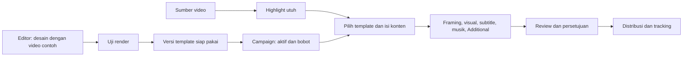

# Analisis Editor pembuat template SSR_CLIPPER

Tanggal: 7 Oktober 2026  
Status: dokumen analisis awal. Tahap awal Editor kini diimplementasikan; lihat [panduan dan batas kemampuan](TEMPLATE_EDITOR_GUIDE.md). Bagian kondisi sistem di bawah merekam keadaan sebelum implementasi.

## 1. Tujuan dan keputusan utama

Membuat halaman **Editor** di SSR_CLIPPER untuk menyusun template secara visual. Pengguna mengatur tampilan melalui preview, kemudian menyimpan template yang bisa dipakai otomatis oleh campaign.

Fokus tahap pertama adalah **membuat template**. Mengedit timeline setiap clip hasil produksi menjadi pengembangan berikutnya. Create Clip tetap memakai sumber video, campaign, jumlah clip, dan cookie.

Rekomendasi: gunakan **Konva.js untuk interaksi kanvas**, pertahankan **MLT dan FFmpeg sebagai mesin render**, lalu buat format desain template milik SSR yang dipahami keduanya. Konva berlisensi MIT dan menyediakan pemilihan, perubahan ukuran, rotasi, serta contoh video yang dapat diputar di kanvas. Konva merupakan fondasi interaksi; timeline, penyimpanan project, dan penghubung ke renderer tetap perlu dibuat. [Lisensi Konva](https://github.com/konvajs/konva/blob/master/LICENSE), [transformasi objek](https://konvajs.org/docs/select_and_transform/Basic_demo.html), [video di kanvas](https://konvajs.org/docs/sandbox/Video_On_Canvas.html).

MLT merupakan framework multimedia untuk komposisi audio/video. Pengguna dapat membuat desain melalui halaman Editor kita, sementara mesin ini bekerja di belakang layar. [MLT](https://www.mltframework.org/).

### Dua sistem tetap dapat bekerja terpisah

| Sistem | Tugas | Hasil |
|---|---|---|
| Pembuat template | Menyusun desain, mencoba hasil, menyimpan versi | Project yang dapat diedit dan paket template |
| Clipper | Menemukan highlight, memilih template, mengisi konten, render | Clip final, metadata, review, distribusi, tracking |

Keduanya boleh diakses dari satu aplikasi. Setelah paket disimpan, proses clipping harus berjalan saat halaman Editor ditutup, tanpa project asal atau program pembuat template. Jika nantinya pembuat template dipisahkan menjadi aplikasi sendiri, kontrak paket yang sama tetap digunakan.

## 2. Dasar analisis referensi

Referensi berasal dari screenshot yang diberikan, serta deskripsi dan transkrip otomatis video **ClipProvit Campaign Otomatisasi Kliping AI**. Saya belum memeriksa seluruh frame video tersebut, dan tidak memiliki source code produknya.

Di screenshot terlihat alat di kiri, preview di tengah, properti di kanan, kontrol timeline, dan daftar clip di bawah. Transkrip demonstrasi membahas pembacaan brief campaign, sumber footage, B-roll, penggeseran elemen, perubahan gaya teks, dan render. Ini menunjukkan alur interaksi yang bisa menjadi referensi; detail mesin dan kualitas implementasinya belum dapat disimpulkan. [Video referensi](https://www.youtube.com/watch?v=fTaJakyTuVA).

| Bagian referensi | Penerapan pada pembuat template |
|---|---|
| Alat vertikal di kiri | Menambah sumber video, subtitle, teks, gambar, bingkai, audio |
| Preview besar | Tempat memilih, menggeser, dan mengubah ukuran objek |
| Pengaturan di kanan | Menampilkan properti objek yang sedang dipilih |
| Play dan timeline | Melihat perubahan desain pada waktu tertentu |
| Area aman | Panduan posisi elemen untuk TikTok dan Instagram |
| Daftar hasil clip | Pada tahap ini diganti dengan layer dan elemen template |
| Render | Menjadi Uji render sebelum template diterbitkan |

Kesederhanaan muncul dari **pengaturan yang sesuai dengan objek terpilih** dan default yang berguna. Menampilkan banyak tombol sekaligus akan membuat editor kembali rumit.

## 3. Kondisi sistem sekarang

Bagian ini diperiksa melalui struktur aplikasi, SDK template, layanan template, dan alur produksi yang ada. Hasil tes historis dalam dokumentasi lama tidak dijalankan ulang untuk analisis ini.

| Kemampuan | Kondisi saat ini | Pekerjaan untuk Editor |
|---|---|---|
| Halaman Editor internal | Belum ada pada navigasi | Tambah library dan workspace Editor |
| Paket template | `.ssrtemplate` dengan manifest, timeline MLT, aset | Perlu format versi baru untuk desain native Editor |
| Render tanpa editor | Sudah tersedia melalui MLT | Digunakan kembali |
| Pilihan template di campaign | Aktif/nonaktif, bobot pemilihan, versi tersimpan | Hubungkan template terbit dari Editor |
| Isi video dan judul dinamis | Placeholder sumber dan judul tersedia | Perluas binding untuk objek Editor |
| Durasi template | Akhir sumber mengikuti durasi clip | Tambah aturan waktu relatif untuk elemen dan animasi |
| Subtitle | Paket eksternal menerima Clean, Social, Bold | Tambah pengaturan font, posisi, ukuran, warna, outline, grouping |
| Caption dalam pipeline | Dibakar setelah visual template | Pastikan memakai desain subtitle dari template baru |
| Musik | Ditentukan dan dicampur melalui alur campaign | Definisikan hubungan gaya mixing template dengan override campaign |
| Framing wajah | Renderer SSR tersedia; preprocessing eksternal speaker/center dibatasi 9:16 | Uji kompatibilitas setiap rasio dan jenis framing |
| Font paket | Belum didukung dalam kontrak paket lama | Tambah registrasi, pemuatan preview, dan resolusi font render |
| Membuka kembali template | Project author memakai Kdenlive | Tambah project native yang bisa diedit di Editor |

Artinya, fondasi produksi sudah ada. Namun sebuah kanvas dengan tombol Simpan belum cukup: desain subtitle, waktu animasi, aset, dan render harus terhubung sampai hasil akhir.

## 4. Apa yang disimpan dalam template?

Template menyimpan **desain dan aturan penerapannya**. Video contoh membantu pengguna melihat desain saat mengedit.

### Isi tetap

- Rasio dan ukuran output.
- Posisi dan ukuran area video.
- Gaya subtitle dan judul.
- Bingkai, warna latar, serta gambar dekorasi.
- Aturan kapan elemen muncul.
- Karakter mixing audio dan animasi yang didukung.

### Isi yang diganti untuk setiap clip

- Video highlight dan suara pembicara.
- Kata-kata subtitle beserta waktunya.
- Judul clip dan teks dinamis lain yang disetujui.
- Musik pilihan campaign.
- Aset campaign jika elemen memang memiliki slot untuknya.

Contoh: template menaruh judul di bagian atas selama empat detik dan subtitle dua baris di bawah. Saat dipakai untuk 51 clip, masing-masing memakai judul, ucapan, dan durasinya sendiri.

Video contoh tidak ikut menjadi sumber produksi. Transkrip contoh juga tidak boleh tersimpan sebagai subtitle tetap untuk seluruh clip.

## 5. User flow lengkap

### A. Membuat template

1. Buka **Editor → Daftar template → Buat template**.
2. Masukkan nama dan pilih rasio. Awal: 9:16, 1:1, 16:9.
3. Pilih video contoh lokal atau clip yang sudah tersedia. Video kosong dengan data contoh tetap dapat digunakan untuk desain awal.
4. Atur area video melalui preview: posisi, ukuran, fit/fill, dan kebijakan framing.
5. Tambahkan subtitle; atur font, warna, jumlah kata, baris, outline, dan posisinya.
6. Tambahkan teks, gambar, latar, atau bingkai yang diperlukan.
7. Atur waktu tampil melalui timeline sederhana.
8. Pilih contoh musik untuk mendengar gaya mixing. Konteks campaign boleh dipilih untuk pengujian tanpa mengikat template ke campaign itu.
9. Putar preview, periksa area aman, lalu klik **Uji render**.
10. Periksa MP4 hasil render, termasuk subtitle dan audio.
11. Simpan draft atau **Terbitkan template** ke library lokal.

“Terbitkan” di sini berarti siap dipilih dalam campaign, bukan publikasi ke internet.

### B. Memakai template

1. Buka campaign dan aktifkan satu atau beberapa template dari library.
2. Atur bobot pemilihan dan Additional yang berlaku.
3. Masukkan sumber video pada Create Clip, pilih campaign, lalu buat job.
4. Sistem menemukan highlight dan memeriksa keutuhan ucapan.
5. Template dipilih per clip dari daftar aktif; pilihan dan versinya disimpan.
6. Filter wajah yang berlaku diperiksa, framing disiapkan, konten dinamis diisi, lalu video dirender.
7. Musik wajib dicampur dan varian Additional diterapkan untuk tujuan sosmed yang sesuai.
8. Hasil masuk ke review, persetujuan, distribusi, dan tracking.

Pemilihan acak dilakukan dari template aktif dengan bobotnya. Percobaan ulang memakai pilihan yang sudah tersimpan agar desain tidak berubah tanpa disengaja.

## 6. Struktur halaman untuk desain UI/UX

### Library template

Kartu menampilkan thumbnail, nama, rasio, versi, status, dan campaign yang menggunakan template. Aksi: buat, buka draft, duplikat, lihat versi, impor, ekspor, arsipkan. Versi yang masih dipakai job tidak boleh hilang karena template diarsipkan.

### Workspace

| Area | Isi | Prinsip interaksi |
|---|---|---|
| Atas | Nama, rasio, status tersimpan, Undo/Redo, Uji render, Terbitkan | Aksi utama mudah ditemukan |
| Kiri | Video, Subtitle, Teks, Gambar, Bingkai, Audio | Menambah elemen; panel bisa ditutup |
| Tengah | Kanvas, play/pause, waktu, zoom, area aman | Manipulasi posisi dan ukuran langsung |
| Kanan | Properti elemen terpilih | Pilih subtitle untuk melihat pengaturan subtitle |
| Bawah | Layer dan timeline | Urutan tumpukan serta waktu tampil |

Tidak ada objek terpilih: panel kanan menampilkan pengaturan kanvas. Gambar terpilih: tampilkan penggantian gambar, rasio ukuran, susunan layer, dan hapus. Posisi serta ukuran diubah melalui drag dan handle. Tombol hapus pada objek juga tersedia, mengikuti pola yang diminta sebelumnya.

Layer berarti susunan elemen yang saling menutupi. Timeline mengatur waktu tampilnya; keduanya memiliki fungsi berbeda.

### Interaksi penting

- Klik untuk memilih; klik ruang kosong untuk melepas pilihan.
- Drag untuk memindahkan; handle sudut untuk memperbesar/perkecil dengan rasio terjaga.
- Panduan tengah dan snapping membantu merapikan posisi.
- Lock layer mencegah objek bergeser; show/hide membantu mengedit.
- Delete menghapus elemen terpilih; Undo memulihkannya.
- Scrub timeline memperlihatkan tampilan pada waktu yang dipilih.
- Area aman dapat dipilih untuk TikTok atau Instagram dan tidak dibakar ke video.
- Draft disimpan otomatis dengan status berhasil/gagal yang jelas.

Visual mengikuti SSR_CLIPPER: workspace terang, sidebar hijau gelap, aksen lime, serta komponen dan tipografi yang sudah ada. Panel dapat dilipat ketika jendela sempit.

## 7. Daftar fitur dan prioritas

Semua fitur pada tabel berikut adalah rancangan Editor, kecuali integrasi backend yang dinyatakan sudah tersedia di bagian 3.

| Fitur | Pengaturan | Tahap |
|---|---|---|
| Library template | Nama, thumbnail, rasio, draft, versi, duplikat, arsip, impor/ekspor | Awal |
| Kanvas | 9:16, 1:1, 16:9, ukuran output, zoom preview | Awal |
| Video dinamis | Slot video highlight, fit/fill, posisi, ukuran, framing kompatibel | Awal |
| Subtitle | Font, ukuran, warna, outline, latar, baris, kata per grup, highlight kata aktif, posisi | Awal |
| Teks | Teks tetap atau judul clip dinamis, gaya dan waktu tampil | Awal |
| Gambar | Beberapa gambar, drag, resize, susunan, hapus | Awal |
| Bingkai dan latar | Warna, border, ruang padding; blur jika sudah lolos uji renderer | Awal |
| Layer | Pilih, lock, hide, duplikat, urutkan | Awal |
| Timeline sederhana | Play, pause, seek, waktu tampil, opening, sepanjang clip, menjelang akhir | Awal |
| Area aman | Panduan TikTok/Instagram, dapat disembunyikan | Awal |
| Audio | Preview suara dan musik, volume, ducking, fade, mengikuti kebijakan campaign | Awal |
| Penyimpanan | Autosave, Undo/Redo, buka kembali project | Awal |
| Uji render | Progress, batal, hasil MP4, pesan kegagalan yang dapat ditindaklanjuti | Awal |
| Publikasi versi | Validasi, paket portable, pilih di campaign | Awal |
| Animasi sederhana | Fade, pop, punch-in/out dengan parameter terbatas | Lanjutan |
| Keyframe | Perubahan posisi, ukuran, dan gerakan pada beberapa titik waktu | Lanjutan |
| Scene dan B-roll | Slot footage, aturan kapan tampil, transisi yang menjaga audio ucapan | Lanjutan |
| Varian rasio | Layout khusus per rasio di dalam satu keluarga template | Lanjutan |
| Aturan adaptif | Penyesuaian desain untuk durasi, panjang judul, atau jumlah pembicara | Lanjutan |
| Bantuan AI | Mengusulkan desain atau mengubah project melalui instruksi | Setelah kontrak editor stabil |
| Edit clip hasil | Membuka komposisi clip tertentu untuk revisi manual | Ruang lingkup berikutnya |

Tahap awal harus dapat membuat template yang benar-benar dipakai merender. Efek yang belum didukung renderer belum muncul sebagai pilihan aktif di UI.

## 8. Aturan durasi: mencegah ucapan terpotong

**Durasi sumber highlight menjadi acuan.** Video contoh 30 detik tidak boleh membuat semua hasil berakhir pada detik 30.

| Aturan waktu | Contoh | Penerapan pada clip lain |
|---|---|---|
| Sepanjang clip | Subtitle dan bingkai | Mengikuti durasi highlight |
| Dari awal | Judul selama 4 detik | Muncul pada pembukaan |
| Dari akhir | Logo penutup selama 2 detik | Ditempatkan dua detik sebelum akhir |
| Persentase durasi | Perubahan framing pada 50% | Menyesuaikan panjang clip |
| Berdasarkan ucapan | Penekanan saat kata tertentu terdengar | Memakai waktu kata dari transkrip; tahap lanjutan |

Jika elemen lebih panjang dari clip, elemen dipendekkan atau dilewati menurut aturan yang jelas; sumber ucapan tetap dipertahankan. Transisi, musik, dan B-roll tidak boleh menjadi penentu batas akhir video.

Editor menjaga agar template tidak memotong sumber. Kelengkapan gagasan dan kalimat tetap bergantung pada highlight finder, transkrip, serta pemeriksaan batas ucapan. Template sendiri tidak dapat menjamin kualitas cerita setiap kandidat.

## 9. Batas tanggung jawab template dan campaign

| Data | Pemilik |
|---|---|
| Desain video, subtitle, judul, bingkai | Template |
| Profil audiens dan kriteria highlight | Campaign |
| Caption publikasi, hashtag, tag akun per sosmed | Campaign dan hasil metadata clip |
| Akun tujuan, jadwal, maks upload per hari | Campaign/profil akun sesuai sistem yang ada |
| Filter wajah target | Additional campaign |
| Watermark wajib, rasio, sosmed, include/exclude template | Additional campaign |
| Sumber musik | Kebijakan musik campaign |
| Karakter mixing | Default template dengan override campaign yang eksplisit |

Untuk audio, usulan urutan prioritas adalah **override yang sengaja ditetapkan campaign → gaya template → default aplikasi**. Data campaign lama perlu migrasi agar nilai default lama tidak dianggap sebagai override pengguna untuk semua template. Audio ucapan tetap utama dan musik tetap wajib.

Gambar dekorasi template dan watermark campaign harus memiliki peran yang jelas agar logo wajib tidak terpasang dua kali. Watermark Additional tetap memakai opasitas 100%, dengan posisi dan ukuran melalui kanvasnya.

Template dapat dipakai lintas campaign. Memilih campaign ketika menguji template hanya menyediakan data contoh. Identitas login Google tetap terpisah dari akun sosmed dan hubungan campaign.

## 10. Cara membangun sistemnya

### A. Pertahankan shell aplikasi

Tambahkan modul Editor pada frontend HTML/CSS/JavaScript dan bridge Python pywebview yang sudah ada. Migrasi seluruh aplikasi ke framework baru tidak diperlukan untuk kemampuan ini. Library kanvas dibundel lokal agar editor tetap berjalan tanpa CDN.

### B. Buat model desain milik SSR

Simpan project sebagai data yang berisi kanvas, layer, aset, gaya subtitle, binding konten, aturan waktu, audio, dan versi format. Data ini menjadi sumber bersama bagi preview dan compiler render.

Jangan menjadikan hasil serialisasi kanvas sebagai satu-satunya project. Dokumentasi Konva menyatakan gambar dan event handler tidak tersimpan dalam serialisasi tersebut; referensi aset dan perilaku editor perlu dikelola aplikasi. [Serialisasi Konva](https://konvajs.org/docs/data_and_serialization/Serialize_a_Stage.html).

### C. Terjemahkan desain ke renderer

Compiler mengubah model desain menjadi komposisi MLT serta pengaturan subtitle/audio untuk FFmpeg. Teks biasa dan judul dinamis dapat menggunakan fasilitas teks MLT; subtitle ucapan memerlukan konfigurasi renderer subtitle yang mengikuti model baru. MLT memiliki pengaturan font, warna, outline, dan geometri pada filter dynamictext, tetapi itu tidak otomatis memperluas kontrak subtitle SSR yang sekarang. [Filter dynamictext](https://www.mltframework.org/plugins/FilterDynamictext/).

Setiap fitur perlu pembuktian render: gambar transparan, fit/fill, outline, pemotongan gambar, maupun animasi. Jika sebuah efek belum bisa diterjemahkan dengan hasil yang stabil, fitur itu belum diterbitkan.

### D. Perluas paket secara berversi

Paket versi lama hanya menerima timeline MLT dan jenis aset yang diizinkan. Project editor serta font tidak dapat ditambahkan begitu saja tanpa memperbarui validator.

Rancangan paket native versi berikutnya memuat:

- Manifest: identitas, versi, kemampuan yang diperlukan, ukuran, dan checksum.
- Model desain yang diperlukan untuk mengisi konten dan menyelesaikan waktu per clip.
- Komposisi render yang sudah disiapkan atau dihasilkan compiler.
- Pengaturan subtitle dan audio.
- Aset gambar/dekorasi; font yang diizinkan untuk dibundel.
- Thumbnail untuk library.

Project editable dapat disertakan sebagai data opsional, tetapi consumer tidak bergantung pada UI atau kode interaksi Editor. Video contoh dan transkrip contoh disimpan terpisah dari paket produksi.

Template eksternal lama tetap dapat dipakai untuk render. Mengubah timeline MLT arbitrer menjadi project yang dapat diedit di Editor membutuhkan konverter tersendiri; tahap awal tidak menjanjikan kemampuan itu.

### E. Bedakan draft dari versi siap pakai

Draft boleh berubah dan autosave. Saat diterbitkan, sistem membuat versi tetap yang menyertakan aset serta identitas isinya. Campaign dan job menyimpan versi tersebut. Revisi desain membuat versi baru; clip yang sudah disetujui tidak berubah otomatis.

### F. Sediakan dua jenis preview

1. **Preview interaktif:** cepat untuk drag, resize, dan mencoba waktu.
2. **Uji render:** MP4 melalui jalur produksi yang sebenarnya, termasuk subtitle dan musik.

Keduanya membaca model desain yang sama. Tetap perlu perbandingan hasil karena font, wrapping teks, efek, dan pembulatan frame browser dapat berbeda dari renderer. Uji render menjadi acuan sebelum publikasi versi.

## 11. Data yang perlu disimpan

| Kelompok | Contoh isi |
|---|---|
| Identitas | ID stabil, nama, versi, status, waktu perubahan |
| Kanvas | Lebar, tinggi, fps, rasio, latar |
| Layer | ID, jenis, posisi, ukuran, urutan, lock, visibility |
| Binding | Video highlight, judul clip, subtitle ucapan, aset tetap |
| Waktu | Acuan awal/akhir/durasi, offset, panjang tampil |
| Subtitle | Font dan fingerprint, ukuran, warna, outline, grouping, posisi |
| Audio | Mixing, ducking, fade, aturan pewarisan campaign |
| Aset | ID, file internal, jenis, ukuran, checksum |
| Kompatibilitas | Versi format, efek yang diperlukan, runtime minimum yang teruji |
| Publikasi | Versi tetap, checksum paket, hasil validasi |
| Project saja | Video contoh, transkrip contoh, posisi playhead, zoom editor |

Posisi elemen mengacu pada ukuran output, terpisah dari zoom tampilan editor. Path file milik pengguna tidak menjadi satu-satunya referensi aset.

## 12. Status dan penanganan masalah

- **Draft:** tersimpan, belum menjadi pilihan produksi.
- **Perlu perbaikan:** ada masalah aset, font, binding, atau fitur render.
- **Sedang diuji:** preview render berjalan; tampilkan progress dan batal.
- **Siap digunakan:** versi sudah divalidasi dan diterbitkan.
- **Diarsipkan:** disembunyikan untuk pemilihan baru; versi untuk job lama tetap tersedia.

Jika preview render gagal, draft tetap tersimpan dan hasil render terakhir yang berhasil tetap dapat dilihat. Pesan kesalahan menyebutkan elemen yang bermasalah dan langkah perbaikannya. Publish diblokir untuk aset/font hilang atau efek yang tidak tersedia.

Contoh pesan yang berguna: “Font pada layer Subtitle belum tersedia. Pilih font lain atau impor font ini.”

## 13. Urutan pengerjaan dan hasil setiap tahap

| Tahap | Pekerjaan | Hasil yang harus dapat diperiksa |
|---|---|---|
| 1. Kontrak dan pembuktian render | Model desain, validator, compiler minimum, waktu relatif | Satu template dengan video, gambar, judul, subtitle dirender pada beberapa durasi |
| 2. Workspace dasar | Library, kanvas, layer, properti, drag/resize, autosave, Undo/Redo | Pengguna membuat dan membuka kembali desain tanpa menulis file manual |
| 3. Subtitle dan audio | Gaya custom, wrapping, kata aktif, mixing, preview | MP4 menunjukkan desain subtitle dan audio yang sesuai |
| 4. Paket dan campaign | Publikasi versi, aset portable, impor/ekspor, pool berbobot | Template baru dipakai pada job saat Editor ditutup |
| 5. Kualitas dan UX | Perbandingan preview/render, error recovery, shortcut, jendela sempit | Jalur pembuatan hingga clip final lengkap dan dapat dipulihkan |
| 6. Pengembangan lanjutan | Animasi, B-roll, scene, varian rasio, bantuan AI | Kemampuan baru ditambahkan setelah lolos uji render |

Tahap pertama membuktikan satu alur kecil sampai MP4. Dengan begitu, rancangan UI bertumpu pada kemampuan yang benar-benar dapat diproduksi.

## 14. Kriteria penerimaan

1. Pengguna membuat template tanpa Kdenlive dan tanpa menulis konfigurasi manual.
2. Template dapat disimpan, dibuka ulang, diduplikat, dan diterbitkan sebagai versi baru.
3. Desain subtitle dari Editor benar-benar digunakan pada clip final.
4. Template contoh 30 detik dapat dipakai untuk sumber 15, 45, 70, dan 120 detik dengan durasi utuh.
5. Judul dari awal serta elemen menjelang akhir menyesuaikan aturan waktunya.
6. Kata terakhir, audio, dan gambar akhir sumber tidak hilang akibat template.
7. Aset paket tetap tersedia meski file gambar asal dipindahkan.
8. Font menghasilkan wrapping dan posisi yang telah dibandingkan antara preview dan render.
9. Area aman, handle, dan panduan editor tidak muncul pada hasil ekspor.
10. Hasil 9:16, 1:1, dan 16:9 diverifikasi; kebijakan framing yang belum kompatibel tidak ditawarkan.
11. Musik selalu hadir sesuai kebijakan campaign dan ucapan tetap terdengar.
12. Additional sesuai rasio/sosmed/include-exclude tetap bekerja dan tidak menggandakan watermark.
13. Job tetap berjalan ketika Editor ditutup dan tanpa akses folder authoring asal.
14. Versi lama tetap dapat merender job lama; edit draft tidak mengubah clip yang disetujui.
15. Membuka halaman Editor tidak memulai download, panggilan AI, atau render otomatis.

## 15. Bahan yang berguna dari pemilik produk

Pengerjaan dasar dapat dimulai dari keputusan di dokumen ini. Untuk menilai kualitas visual, siapkan beberapa video contoh, satu atau dua hasil editing yang disukai dengan catatan bagian yang disukai, font, gambar dekorasi, dan musik contoh. Gunakan contoh dengan kalimat pendek/panjang dan posisi pembicara berbeda agar desain tidak hanya bagus pada satu video.

Untuk desain UI, prioritaskan library, workspace saat objek kosong/terpilih, pengeditan subtitle, progress Uji render, error, dan publikasi versi. Kerangka halaman serta istilahnya sudah cukup jelas untuk diterjemahkan ke wireframe.

## 16. Titik integrasi untuk developer

- `web/components/header.js` dan `web/app.js`: navigasi dan lifecycle halaman baru.
- `app.py`: bridge API project, aset, preview render, dan publikasi.
- `template_sdk/ssr_template_engine/package.py`: format paket, validasi, versi, instansiasi.
- `services/external_templates.py`: library dan preset template untuk campaign.
- `services/mlt_runtime.py`: render tanpa program authoring.
- `services/core_workflow.py`: penerapan gaya subtitle/audio dan template pada clip.
- `web/components/campaign-edit.js`: pilihan template aktif dan bobot.

Dokumentasi fondasi yang sudah ada: [TEMPLATE_SYSTEMS.md](<E:/PROJECT/Vibe code/C-Project/yt-short-clipper-2.0.5-beta/docs/TEMPLATE_SYSTEMS.md>), [CAMPAIGN_TEMPLATES_AND_JOBS.md](<E:/PROJECT/Vibe code/C-Project/yt-short-clipper-2.0.5-beta/docs/CAMPAIGN_TEMPLATES_AND_JOBS.md>), dan [CAMPAIGN_ADDITIONALS.md](<E:/PROJECT/Vibe code/C-Project/yt-short-clipper-2.0.5-beta/docs/CAMPAIGN_ADDITIONALS.md>).

## Kesimpulan

Editor internal yang sesuai kebutuhan ini adalah pembuat desain yang dapat digunakan berulang oleh mesin clipping. Fondasi render dapat dipertahankan. Pekerjaan utamanya adalah interaksi visual, model template dinamis, perluasan subtitle dan waktu, serta penyamaan preview dengan jalur produksi. Keberhasilan diukur dari template buatan pengguna yang benar-benar menghasilkan clip sesuai desain, dengan ucapan utuh dan Editor tidak perlu berjalan saat produksi.
