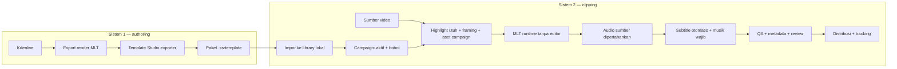

# Dua sistem template SSR_CLIPPER

Implementasi awal · 27 September 2026 · tanpa menjalankan GUI/editor atau API AI berbayar.

**Pembaruan 7 Oktober 2026:** SSR_CLIPPER kini menyediakan [Editor template native](TEMPLATE_EDITOR_GUIDE.md) untuk membuat desain tanpa Kdenlive. Alur Kdenlive/MLT di bawah tetap tersedia; paket native memakai renderer FFmpeg dan dapat dijalankan saat Editor ditutup.

## Keputusan open source

**Kdenlive** menjadi editor untuk membuat template. Repositori: https://invent.kde.org/multimedia/kdenlive.
**MLT/melt** menjadi runtime komposisi di SSR_CLIPPER. Repositori: https://github.com/mltframework/mlt.

Alasannya konkret: Kdenlive dapat mengekspor render script `.mlt`, dan dokumentasi resminya
menunjukkan rendering script tersebut melalui `melt`, terpisah dari editor.
MLT mempunyai format XML untuk producer, track, filter, dan transition.

- [Dokumentasi render Kdenlive](https://docs.kdenlive.org/en/exporting/render.html)
- [Format MLT XML](https://www.mltframework.org/docs/mltxml/)
- [CLI melt](https://www.mltframework.org/docs/melt/)
- [Distribusi resmi Kdenlive untuk Windows](https://kdenlive.org/download/)

Ini adalah integrasi **paket template render yang dibatasi dan divalidasi**, bukan janji bahwa semua
file `.kdenlive`, efek, plugin, font, atau project arbitrer bisa langsung dipakai otomatis.

## Arsitektur



Tidak ada komunikasi antaraplikasi pada saat produksi. File paket adalah titik serah-terima.
Sistem 2 tidak mengimpor modul Template Studio, membuka Kdenlive, atau membaca folder project authoring.
SDK format merupakan library Python kecil yang dibundel terpisah di masing-masing distribusi;
bukan program tambahan yang harus berjalan.

| Komponen | Sistem 1 | Sistem 2 |
|---|---|---|
| Kdenlive/editor | Untuk menyusun desain secara visual | Tidak diperlukan |
| Template Studio exporter | Membuat paket | Tidak diperlukan |
| SDK format | Validasi dan ekspor | Validasi, impor, instansiasi |
| MLT/melt | Dipakai editor untuk preview/render | Runtime lokal untuk komposisi otomatis |
| Timeline dan aset | Project authoring | Salinan dalam library lokal |
| API AI, subtitle, pemilihan musik | Tidak diperlukan untuk exporter | Tetap memakai integrasi SSR yang tersedia |

## Sistem 1 — membuat template

Toolkit berada di [template_studio](../template_studio/README.md), punya `pyproject.toml` dan CLI
sendiri. SDK di [template_sdk](../template_sdk/pyproject.toml). Keduanya dapat dibangun menjadi wheel
dan dipasang di komputer author tanpa source code SSR_CLIPPER.

Alur pengguna:

1. Buat project Kdenlive dengan ukuran/fps tujuan.
2. Pasang video contoh sebagai **satu rentang utuh**, dimulai dari frame 0 sampai akhir timeline.
3. Desain efek, warna, track overlay, gambar/logo, dan teks. Gunakan `{{SSR_TITLE}}` pada Dynamic Text
   untuk judul yang akan diisi oleh sistem clip.
4. `Render → Generate Script` menghasilkan render `.mlt`.
5. Jalankan exporter, pilih source placeholder, nama/ID/versi, framing source dan style subtitle.
6. Kirim paket `.ssrtemplate` ke komputer SSR. Folder project tetap milik author.

```powershell
# Dari direktori template_studio, menggunakan Python lingkungan author
python -m pip install ../template_sdk .
ssr-template-export render.mlt motivasi.ssrtemplate --source contoh.mp4 --id motivasi --name "Motivasi" --version 1 --subtitle-style bold --source-framing fit
```

[portrait.mlt](../template_studio/examples/portrait.mlt) adalah starter MLT sederhana: brightness,
judul dinamis, kanvas vertikal. Ini contoh kontrak yang valid, bukan salinan template video referensi.

## Sistem 2 — memakai template

Runtime Windows telah dipasang lokal di `_runtime/mlt`. Sumbernya distribusi KDE **26.08.1** yang
checksum SHA-256-nya diperiksa; executable `melt` melaporkan **7.41.0**.
Installer tidak menjalankan installer/editor Kdenlive. Executable editor dikeluarkan dari salinan
runtime. Modul hardware I/O/OFX dan integrasi yang tidak diperlukan tidak dimuat oleh renderer.

Untuk komputer lain:

```powershell
python tools/setup_mlt_runtime.py
python tools/template_cli.py status
```

Installer membutuhkan CLI 7-Zip dan akses download resmi. Runtime tidak dipasang otomatis pada startup.
Jika runtime belum tersedia, impor template memberikan error yang jelas; preset lama tetap bekerja.
Linux/macOS belum diuji: gunakan distribusi MLT platform dan `SSR_MLT_PATH` ke executable `melt`.

Alur pengguna setelah runtime tersedia:

1. Buka pengeditan campaign → **Impor template Kdenlive** → pilih `.ssrtemplate`.
2. Template baru muncul dalam daftar; aktifkan dan atur bobot, lalu simpan campaign.
3. Create Clip tetap hanya sumber, campaign, jumlah, cookie.
4. Sistem memilih template per clip. Versi pilihan disimpan untuk retry dan revisi.
5. MLT mengomposisi visual; SSR mempertahankan audio sumber, membuat subtitle, lalu mencampur musik wajib.
6. Hasil final beserta metadata memasuki review/distribusi/tracking yang sudah ada.

CLI untuk diagnosis tanpa GUI:

```powershell
python tools/template_cli.py import motivasi.ssrtemplate
python tools/template_cli.py render mlt:motivasi:v1 clip-siap.mp4 hasil.mp4 --title "Judul clip"
```

CLI render hanya komposisi visual + audio sumber. Subtitle AI dan musik wajib dijalankan oleh alur
produksi campaign, bukan oleh CLI diagnostik ini. Preview template juga hanya memperlihatkan komposisi
dan judul dinamis; video final mempunyai tahap subtitle/musik tambahan.

## Kontrak paket versi 1

```text
motivasi.ssrtemplate (ZIP)
├── manifest.json
├── timeline.mlt
└── assets/ (gambar, video, audio/luma lokal yang direferensikan timeline)
```

Manifest menyimpan format/schema, ID/versi/nama, ukuran/fps, durasi contoh, subtitle style,
framing source, daftar layanan MLT, dan SHA-256 setiap file. Nama preset consumer berbentuk
`mlt:motivasi:v1`; paket disalin ke `template_library/motivasi-v1`.

- Source placeholder menjadi `{{SSR_SOURCE}}`; file contoh tidak ikut paket.
- Batas akhir timeline/source/effect sepanjang project menjadi `{{SSR_LAST_FRAME}}` dan
  panjangnya `{{SSR_FRAME_COUNT}}`.
- Saat render, SSR mengisi path clip lokal dan jumlah frame berdasarkan durasi clip.
  Source track tidak boleh membatasi sumber ke durasi contoh atau menggunakan offset awal.
- Teks `{{SSR_TITLE}}` diisi melalui serializer XML; karakter `&`, `<`, dan tanda kutip tetap aman.
- File dipastikan tetap dalam paket; URL, absolute external path, script, DTD/entity,
  nested project, dan efek di luar daftar kompatibel ditolak.
- Payload dibatasi 256 file (ditambah manifest) dan 512 MiB setelah ekstraksi. Metadata author/proxy lama dibersihkan.
- Impor versi yang sama dengan isi berbeda ditolak. Perubahan desain menggunakan versi baru;
  versi lama tetap tersedia bagi campaign/job lama.
- Template yang hilang/rusak, efek tidak tersedia, runtime tidak ada, atau hasil render yang kehilangan
  durasi/dimensi menjadi error. Tidak ada fallback diam-diam ke desain berbeda.

## Batas kompatibilitas yang berlaku sekarang

1. Source satu rentang utuh per track; template dengan cut sumber, jeda awal, atau intro/outro
   sesudah source ditolak. Sisipan/penutup campaign tetap disusun oleh SSR sebelum komposisi template.
2. Filter sepanjang project mengikuti durasi clip. Keyframe/efek pendek di tengah masih memakai
   waktu desain asli. Animasi akhir dengan posisi waktu tetap belum dapat disesuaikan otomatis.
3. Subtitle otomatis memakai renderer Clean/Social/Bold yang sudah ada. Membuat gaya subtitle baru
   secara bebas melalui template Kdenlive belum didukung.
4. Audio tambahan/mix template tidak dipakai; narasi sumber dan musik campaign dikendalikan SSR.
5. Kdenlive Title XML, timewarp, GPU effects, QML/script, nested sequence, dan font custom terbundel
   belum didukung. Gunakan media overlay yang sudah dirender untuk dekorasi yang memerlukannya.
6. Membuka kembali project hasil tiap clip untuk mengedit secara manual belum disediakan. File final
   tetap dapat diedit di editor secara terpisah; ini bukan round-trip timeline otomatis.
7. Preset Standar dan Podcast Kotak tetap menggunakan mesin lama. Migrasi desain keduanya ke paket MLT
   belum dikerjakan. Import bukan janji bahwa hasil video referensi langsung identik 100%.
8. `fit` memasok frame utuh ke komposisi MLT. Preprocessing `speaker`/`center` memakai renderer portrait
   SSR per clip, memerlukan template 9:16; framing tersebut dicatat tanpa mengubah config worker lain.

## Verifikasi

- Export → import → folder authoring dihapus → MLT tetap merender sumber baru.
- Render nyata durasi **1,4 dan 34,2 detik** dari template contoh 3 detik: ukuran, audio, durasi,
  dan efek brightness diperiksa. Tidak ada batas 30 detik dari template.
- Alur `process_clip` diuji dengan MLT sungguhan, subtitle yang dibakar lokal dan musik yang dicampur
  sungguhan. Hanya panggilan transkripsi berbayar yang diganti fixture.
- Versi immutable, checksum, path traversal, script/DTD, sumber terpotong, pemilihan acak,
  dan metadata provenance diuji.
- Editor/GUI, layanan AI, akun provider dan upload produksi tidak dijalankan untuk verifikasi ini.
- Regresi akhir: **203 tes Python + 17 tes DOM lulus**. Wheel authoring/SDK berhasil dibangun.
- Ekspor toolkit juga diuji di Python terisolasi memakai wheel saja. Program author dan project
  dihapus sebelum render consumer; bukti ada di `output/template-distribution/proof/proof.json`
  dan video `proof-without-editor.mp4`. Paket demo ada di folder yang sama, belum diaktifkan pada campaign produksi.

Kode utama: [package.py](../template_sdk/ssr_template_engine/package.py),
[external_templates.py](../services/external_templates.py), [mlt_runtime.py](../services/mlt_runtime.py),
[core_workflow.py](../services/core_workflow.py), [test_mlt_templates.py](../tests/test_mlt_templates.py).
