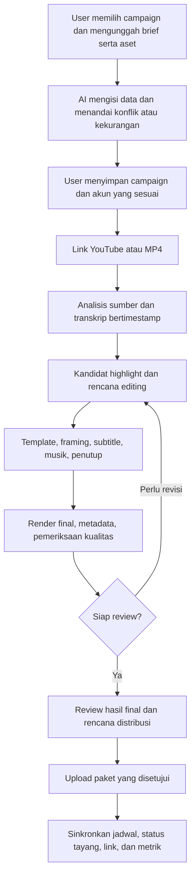

# Rencana Upgrade SSR_CLIPPER

Tanggal: 18 September 2026  
Status: alur utama sudah diimplementasikan dan diuji lokal; beberapa target lanjutan masih terbuka. Lihat [status implementasi](IMPLEMENTATION_STATUS.md) untuk bukti pengujian dan pekerjaan tersisa.  
Dasar: percakapan kebutuhan, brief contoh, peta alur, pemeriksaan kode lokal, dan dokumentasi integrasi.

## 1. Hasil yang dituju

User memilih campaign dari platform mana pun, mengunggah beberapa dokumen dan aset, mengoreksi hasil pengisian AI, kemudian memakai campaign tersebut berulang kali. Untuk produksi, user memilih campaign dan memasukkan link YouTube atau file MP4. Sistem menghasilkan konten sesuai brief, metadata individual, dan paket publikasi. User me-review hasil final, menekan Upload/Distribusikan, lalu memantau status tayang dan performa konten.

Setiap akun memiliki satu genre atau lingkup audiens yang konsisten. Akun dapat mengerjakan beberapa campaign yang cocok dengan lingkup tersebut. Penemuan campaign dilakukan user. Pembayaran, klaim pendapatan, dan pencairan uang berada di luar cakupan.

Review sebelum publikasi tetap menjadi perilaku awal. Operasi tanpa review per clip merupakan mode lanjutan yang dapat diaktifkan user untuk campaign tertentu setelah kualitasnya terbukti.

## 2. Prinsip produk dan keputusan awal

- Campaign menyimpan aturan, aset, dan preferensi; seluruh tahap membaca versi campaign yang sama untuk satu pekerjaan.
- Aturan wajib mengalahkan preferensi gaya. Dokumen yang saling bertentangan ditandai, bukan diputuskan diam-diam oleh AI.
- AI membantu memilih cerita, mengisi data, serta memilih/menyesuaikan template. Renderer mengeksekusi rencana editing yang terstruktur dan tervalidasi.
- Template menjadi komponen inti. Tingkat kebebasan AI ditentukan per komponen dan diuji terhadap kualitas hasil.
- Musik dan seluruh perubahan visual selesai sebelum review. File final yang disetujui adalah file yang diunggah.
- Revisi video, musik, caption publikasi, atau akun tujuan membatalkan persetujuan yang relevan dan meminta review ulang pada mode review.
- Kandidat highlight boleh overlap. Hubungan overlap dibawa sampai distribusi; aturan awal mencegah segmen yang overlap dipublikasikan ke akun yang sama untuk campaign dan sumber yang sama, termasuk lintas batch/hari.
- Kualitas sumber membatasi detail output. Ekspor 1080x1920 tidak dijadikan bukti bahwa sumber rendah resolusi menjadi tajam.
- Status jadwal dibuat, sedang diproses provider, dan benar-benar terbit harus terpisah.
- Data yang tidak tersedia ditampilkan sebagai belum tersedia, bukan angka nol atau status sukses.

## 3. Baseline sebelum upgrade

| Bagian | Bukti kode | Arah upgrade |
| --- | --- | --- |
| Campaign dan ekstraksi brief | `app.py: extract_campaign_brief`, `web/components/campaign-edit.js` | Input beberapa file, penggabungan aturan, sumber setiap nilai, aset wajib |
| Produksi clip | `clipper_core.py: process`, `find_highlights`, `process_clip` | Input lokal, konteks campaign penuh, penyusunan beberapa segmen |
| Subtitle dan hook | `_build_ass_*`, `add_hook_with_progress` | Registry template dengan preview dan versi |
| Face tracking | `convert_to_portrait_*`, `_calculate_lip_activity` | Identitas track stabil, pemisahan scene, pemilihan pembicara, fallback komposisi |
| Musik | `app.py: _select_background_sound`, `_mix_music_into_video` | Pindah ke produksi; musik wajib, preview, volume adaptif |
| Metadata | `process_clip` menulis `data.json` | Caption per clip/platform, versi editing, bukti pemeriksaan |
| Distribusi | `preview_distribution`, `confirm_distribution` | Kecocokan audiens, kuota lintas batch, zona waktu, pencegahan duplikasi |
| Tracking | `get_campaign_stats`, `_upload_scheduler` | Rekonsiliasi status provider dan statistik per konten |

Temuan awal yang menentukan urutan pekerjaan: musik sebelumnya ditambahkan ketika konfirmasi upload; membuat jadwal langsung dicatat sukses; scheduler lama dinonaktifkan; pekerjaan belum tersimpan sebagai antrean persisten; update dependency dan polling memiliki masalah. Perubahan atas baseline ini dicatat dalam laporan implementasi.

## 4. Alur target

## 5. Paket pekerjaan dan kriteria selesai

### M0. Baseline dan stabilitas — dikerjakan pertama

**Pekerjaan**

- FND-01: inventarisasi perilaku saat ini, simpan hasil pembanding, dan pisahkan perubahan lokal yang sudah ada sebelum implementasi.
- FND-02: perbaiki update dependency, perbandingan versi, pengecekan status berulang, dan hasil/error pekerjaan instalasi.
- FND-03: siapkan pengujian terisolasi dengan provider palsu; hindari skrip E2E lama yang mengubah konfigurasi nyata atau mengirim konten secara langsung.
- FND-04: tetapkan kumpulan referensi awal: 12 potongan pendek dan 2 sumber panjang yang mewakili podcast, banyak pembicara, trailer, gerak, wajah tertutup, dan tanpa wajah. Ambil materi lokal yang sesuai bila tersedia.

**Selesai bila:** alur lama masih berjalan, perubahan lokal tetap terjaga, kegagalan dependency terlihat jelas, dan contoh video memiliki hasil baseline serta catatan kualitas.

### M1. Penyimpanan pekerjaan dan kontrak data

**Pekerjaan**

- DATA-01: tambah lapisan penyimpanan; usulan awal SQLite untuk data yang sering berubah dan memerlukan transaksi, sementara video tetap berupa file.
- DATA-02: simpan `CampaignVersion`, `AccountProfile`, `Asset`, `SourceAnalysis`, `Job`, `ClipPlan`, `ClipRevision`, `Publication`, dan `MetricSnapshot` dengan ID stabil.
- DATA-03: tambahkan status per tahap, checkpoint, pembatalan, retry terbatas, serta pemulihan setelah restart. Tahap selesai tidak diulang tanpa perubahan input atau konfigurasi.
- DATA-04: migrasikan metadata lama secara bertahap dengan backup, validasi jumlah/relasi, impor yang aman diulang, serta jalur pemulihan. Pilih satu penyimpanan sebagai sumber kebenaran sesudah migrasi; hindari dua penulis independen.
- DATA-05: simpan versi template, aturan, sumber, dan checksum hasil final; batasi penulisan bersamaan dan pisahkan ruang file sementara tiap pekerjaan.

**Selesai bila:** restart di tengah render mempertahankan hasil yang selesai; satu clip gagal tidak menggagalkan semua clip; metadata lama tetap bisa ditemukan; dua proses tidak menimpa data yang sama.

**Dependensi:** M0.

### M2. Campaign, beberapa file, dan profil akun

**Pekerjaan**

- CMP-01: dukung beberapa PDF, DOCX, gambar brief, teks, video materi campaign, logo/poster, serta musik. Bedakan dokumen aturan, aset editing, dan video sumber produksi.
- CMP-02: gabungkan ekstraksi AI menjadi form; setiap nilai penting menyimpan sumber file/halaman dan status diketahui, belum lengkap, atau konflik. Penggantian brief menampilkan perubahan dan mempertahankan koreksi user.
- CMP-03: perluas aturan menjadi platform, topik/audiens, narasi, CTA, durasi, rasio, materi wajib, musik wajib, penutup, batas proporsi materi luar, mention, hashtag, larangan, dan masa aktif jika tersedia.
- CMP-04: bangun halaman akun dengan genre/lingkup audiens, bahasa, platform, zona waktu, kapasitas harian, dan campaign yang cocok. AI menyarankan kecocokan, user menetapkan profil dan penugasan akun.
- CMP-05: pemeriksaan kesiapan campaign. Aset wajib yang belum diunggah dan konflik aturan terlihat sebelum produksi.

**Selesai bila:** beberapa lampiran menjadi satu campaign yang dapat digunakan ulang; aturan yang tidak ada tidak dikarang; campaign yang tidak cocok tidak mendapat akun hanya karena akun tersebut kosong.

**Dependensi:** M1.

### M3. Input video dan analisis materi

**Pekerjaan**

- SRC-01: tambahkan pemilihan/drag-drop MP4 lokal dan link YouTube, dengan pemeriksaan durasi, orientasi, frame rate, audio, serta ketersediaan file.
- SRC-02: simpan transkrip bertimestamp kata/segmen. Pakai subtitle sumber bila sesuai; gunakan transkripsi ketika tidak tersedia atau tidak layak. Validasi offset pada segmen dan media dengan frame rate variabel.
- SRC-03: cache berdasarkan identitas konten dan versi analisis; satu sumber dianalisis sekali dan dapat dipakai beberapa clip/campaign.
- SRC-04: tambahkan deteksi pergantian scene, bagian tanpa dialog, dan indeks materi campaign. Untuk trailer/visual yang tidak terwakili transkrip, gunakan sampel frame dan analisis visual terarah.
- SRC-05: pencarian highlight membagi sumber panjang menjadi bagian dengan konteks yang bertumpang tindih. Skor mempertimbangkan kecocokan brief, keutuhan cerita, potensi hook, dan kualitas sumber; batas jumlah/biaya tetap dapat diatur.

**Selesai bila:** MP4 dan YouTube masuk ke tahap produksi yang sama; sumber panjang tidak kehilangan konteks di batas bagian; render ulang template tidak mengunduh atau mentranskripsi ulang.

**Dependensi:** M1–M2.

### M4. Sistem template dan rencana editing

**Pekerjaan**

- EDT-01: ubah gaya subtitle yang ada menjadi registry template berversi. Parameter mencakup font, ukuran, posisi aman, baris, timing, penekanan kata, warna, dan animasi yang didukung renderer.
- EDT-02: susun keluarga template: subtitle; judul/hook; framing satu/dua pembicara atau fit; sisipan materi; CTA/penutup; watermark/credit; profil audio. Paket gaya merupakan kombinasi komponen ini.
- EDT-03: definisikan `ClipPlan`: daftar sumber dan rentang waktu, urutan segmen, penempatan aset, template, musik, framing, teks, serta aturan yang dipenuhi. AI menghasilkan data sesuai schema; eksekusi bebas kode dari model tidak diperlukan.
- EDT-04: dukung potongan tunggal dan susunan beberapa sumber, termasuk hook luar + trailer + penutup. Hitung proporsi berdasarkan timeline final, termasuk transisi/overlap, agar durasi tidak dihitung dua kali.
- EDT-05: sediakan pilihan template manual, rekomendasi AI, kunci parameter user, dan preview sampel. Override yang melanggar aturan wajib harus terlihat.

**Selesai bila:** sedikitnya tiga paket gaya awal dapat di-preview dan dipakai ulang; parameter valid menghasilkan render konsisten; durasi subtitle dan CTA mengikuti timeline akhir; aturan proporsi materi dapat diverifikasi.

**Dependensi:** M2–M3. Fondasi renderer tetap menggunakan FFmpeg/ASS yang sudah ada; renderer tambahan dipilih hanya jika efek yang diperlukan tidak dapat dicapai dengan kualitas memadai.

### M5. Musik dan kualitas audio

**Pekerjaan**

- AUD-01: pindahkan pemilihan dan mixing musik ke produksi sebelum review. Simpan versi final lokal; `confirm_distribution` hanya mengirim hasil yang sudah disetujui.
- AUD-02: prioritas musik: aset wajib campaign, pilihan user, lalu rekomendasi AI bila campaign membolehkan. Aset wajib gagal tidak boleh diam-diam berubah menjadi tanpa musik.
- AUD-03: preview lagu dan titik masuk, fade awal/akhir, looping yang rapi, volume dasar, serta penurunan musik ketika dialog muncul. Profil mixing mengikuti jenis konten.
- AUD-04: pertahankan dialog, ukur loudness/peak, gunakan durasi hasil render aktual, dan hindari pemotongan hook/penutup oleh audio yang terlalu pendek.
- AUD-05: simpan asal aset dan informasi penggunaan/atribusi yang tersedia. Musik tertanam dalam video dan sound native platform merupakan mode berbeda; mode native dibatasi kemampuan connector yang telah dibuktikan.

**Selesai bila:** video review sama dengan paket upload; pergantian musik memicu render revisi tanpa mengulang transkrip; dialog terdengar jelas; kegagalan musik wajib masuk status perlu revisi.

**Dependensi:** M4. FFmpeg memiliki filter mixing, normalisasi, dan kompresi sidechain yang relevan; preset dipilih melalui uji dengar, bukan angka universal. [Dokumentasi FFmpeg](https://ffmpeg.org/ffmpeg-filters.html).

### M6. Face tracking dan framing

**Pekerjaan**

- FACE-01: ukur baseline: wajah terpotong, target salah, crop bergetar, pergantian tidak perlu, serta biaya analisis.
- FACE-02: gunakan identitas track yang stabil antarframe; jangan memperlakukan urutan deteksi wajah sebagai identitas orang. Reset track pada pergantian scene.
- FACE-03: gabungkan gerak bibir, kontinuitas wajah, konteks shot, dan sinyal audio bila terbukti membantu. Tambahkan jeda pergantian target, ambang keyakinan, batas kecepatan crop, dan ruang di sekitar kepala.
- FACE-04: sediakan fallback: menahan framing, dua pembicara, atau fit dengan latar; trailer dan adegan tanpa wajah tidak dipaksa menggunakan crop pembicara.
- FACE-05: tampilkan preview framing dan koreksi per segmen berupa kunci target/posisi. Simpan keputusan kamera agar tidak berubah saat render ulang.
- FACE-06: bandingkan peningkatan tracker saat ini dengan pendekatan/model lain pada kumpulan referensi yang sama. Pilihan model dibuat setelah kualitas, kecepatan, penggunaan memori, dan kelayakan distribusinya dinilai.

**Selesai bila:** kasus satu orang, dua orang, banyak orang, wajah tertutup, gerak cepat, cut, serta tanpa wajah punya hasil yang masuk akal; fallback aktif saat keyakinan rendah; laporan perbandingan menunjukkan perbaikan tanpa regresi berat.

**Dependensi:** M3–M4. Dapat dikembangkan sebagai jalur kerja tersendiri setelah format `ClipPlan` stabil.

### M7. Metadata, pemeriksaan hasil, dan review

**Pekerjaan**

- QA-01: buat caption publikasi individual berdasarkan isi clip dan campaign, beserta judul, CTA, mention, hashtag, platform tujuan, dan sumber materi. Bedakan caption publikasi dari subtitle dalam video.
- QA-02: kaitkan metadata dengan revisi video, campaign, template, audio, dan overlap sumber. Perubahan brief tidak mengubah paket yang sudah disetujui tanpa tindakan eksplisit.
- QA-03: pemeriksaan teknis: file dapat dibaca, dimensi/durasi benar, audio tersedia bila diwajibkan, sinkronisasi, area teks, batas proporsi, aset/penutup wajib, metadata wajib. Pemeriksaan isi/emosi oleh AI menjadi sinyal review; bukan bukti mutlak kepatuhan.
- QA-04: halaman review berisi video final dengan musik, caption yang dapat diedit, akun/jadwal tujuan, serta alasan clip perlu diperiksa. Sediakan approve, reject, dan revisi spesifik: subtitle, musik, framing, atau metadata.
- QA-05: perubahan satu bagian hanya mengulang tahap yang terpengaruh. Persetujuan merekam checksum file dan versi metadata/paket tujuan.

**Selesai bila:** semua clip memiliki identitas campaign dan metadata publikasi; pelanggaran wajib tidak lolos sebagai siap upload; revisi subtitle tidak mengulang download; user bisa menilai persis materi yang akan dikirim.

**Dependensi:** M4–M6.

### M8. Distribusi, upload, dan tracking

**Pekerjaan**

- PUB-01: filter akun berdasarkan penugasan campaign, kecocokan lingkup audiens, platform, dan koneksi. Baru setelah itu seimbangkan beban.
- PUB-02: hitung kuota dengan seluruh publikasi tersimpan, termasuk campaign dan batch lain. Reservasi slot secara atomik; simpan waktu UTC dan zona waktu akun untuk tampilan serta perhitungan hari.
- PUB-03: cek overlap lintas batch/hari dengan ID sumber dan rentang waktu global. Jangan hanya mengandalkan nomor conflict group lokal yang dapat berulang.
- PUB-04: antrean upload persisten dengan status `queued`, `uploading`, `scheduled`, `publishing`, `published`, `failed`, dan `needs_attention`. Satu clip dapat memiliki beberapa publikasi ke akun berbeda.
- PUB-05: cegah duplikasi saat double-click, restart, atau respons timeout. Simpan ID storage/schedule; cek status provider sebelum retry yang hasil sebelumnya tidak pasti. Jika belum dapat direkonsiliasi, tandai untuk diperiksa.
- PUB-06: sinkronkan status schedule dan ID/link posting. Jadwal dibuat tidak langsung dihitung sebagai konten tayang. Terapkan pagination, retry dengan jeda meningkat, serta penyegaran yang tidak bertumpuk.
- PUB-07: dashboard per konten, akun, dan campaign: status tayang, link, waktu, error, metrik yang tersedia, dan waktu sinkronisasi terakhir. Sertakan riwayat metrik dan ekspor CSV; nilai tidak tersedia tetap kosong.

**Selesai bila:** campaign salah genre tidak terdistribusi; jadwal menghormati kuota global dan zona waktu; retry tidak membuat posting ganda; statistik tampil sebagai data provider; pembuatan jadwal dan publikasi nyata terlihat terpisah.

**Dependensi:** M1–M2 dan M7 untuk pengiriman final. Prototipe status/rekonsiliasi dengan provider palsu dimulai sejak M1 agar integrasi tidak menjadi kejutan di akhir.

Dokumentasi Repliz menyediakan pembacaan status schedule dan statistik konten. Field metrik berbeda menurut platform; ketersediaan pada akun/paket user harus diuji pada awal proyek. [Get Schedule](https://docs.repliz.com/api/schedule/get-schedule), [Get Statistic](https://docs.repliz.com/api/content/get-statistic).

### M9. Operasi otomatis dan penyempurnaan kualitas

**Pekerjaan**

- AUTO-01: mode awal menjalankan produksi, antrean publikasi yang disetujui, retry, dan tracking otomatis. Review per clip tetap tersedia sebagai default.
- AUTO-02: setelah benchmark dan pilot lulus, tambah mode otomatis per campaign dengan template/aset yang diizinkan, batas pekerjaan, akun, kuota, serta aturan kapan harus kembali ke review. Pilihan ini memerlukan pengaktifan eksplisit oleh user.
- AUTO-03: antrean sumber batch, pembatasan CPU/RAM/GPU, antrean khusus encoder, batas permintaan AI, dan pause/cancel yang dapat dipulihkan. Jumlah worker mengikuti kapasitas yang diukur.
- AUTO-04: status aplikasi tertutup/offline terlihat jelas. Proses lokal berlanjut saat aplikasi/worker berjalan; schedule yang sudah diserahkan ke provider mengikuti layanan provider. Mode worker latar terpisah dapat ditambahkan bila diperlukan.
- AUTO-05: ringkasan perhatian: aset hilang, koneksi akun putus, publikasi gagal, atau kualitas meragukan. Catat waktu, biaya pemakaian AI yang tersedia, dan tingkat revisi per tahap.
- AUTO-06: bandingkan template tetap, AI memilih template, dan AI menyesuaikan struktur pada input sama. Gunakan penilaian video dan data performa sebagai masukan rekomendasi; jangan menyimpulkan satu template menyebabkan views naik hanya dari korelasi.

**Selesai bila:** kumpulan pekerjaan dapat dijalankan dengan intervensi hanya pada titik yang dipilih user atau kegagalan; restart tidak menghilangkan progres; batas kuota dipatuhi; kualitas diukur dari hasil video dan kebutuhan revisi.

**Dependensi:** M0–M8 lulus; mode tanpa review belum diaktifkan hanya karena fiturnya selesai ditulis.

## 6. Bentuk arsitektur yang diusulkan

Pertahankan Python, pywebview, HTML/CSS/JS, serta renderer yang sudah ada. Ekstrak tanggung jawab secara bertahap saat fitur terkait dikerjakan:

| Area usulan | Tanggung jawab |
| --- | --- |
| `services/campaigns/` | Ekstraksi, versi brief, validasi, profil akun |
| `services/media/` | Ingest, transkripsi, analisis scene dan sumber |
| `services/editing/` | ClipPlan, template, framing, audio, render, QA |
| `services/publishing/` | Distribusi, antrean, connector, rekonsiliasi |
| `services/tracking/` | Status publikasi, metrik, ringkasan |
| `storage/` | Transaksi, migrasi, referensi file, riwayat pekerjaan |
| `web/components/` | Campaign, akun, template, produksi, review, tracking |

`app.py` tetap menjadi bridge UI. Metode lama dapat menjadi adapter sementara. `clipper_core.py` dipisah berdasarkan fungsi yang sedang ditingkatkan; ekstraksi besar sekaligus tidak menjadi prasyarat menghasilkan fitur pertama.

## 7. Urutan rilis yang bisa dicoba

| Rilis | Paket | Demo yang wajib tersedia |
| --- | --- | --- |
| A: Fondasi campaign | M0–M2 | Beberapa brief + aset menjadi satu campaign, akun sesuai audiens, data tersimpan |
| B: Produksi terpadu | M3–M5 | MP4/YouTube menjadi clip bertemplate dengan musik final sebelum review |
| C: Kualitas dan review | M6–M7 | Framing lebih baik, koreksi cepat, metadata individual, review paket final |
| D: Distribusi dan tracking | M8 | Upload terkontrol, status tayang nyata, link dan metrik |
| E: Otomasi lanjutan | M9 | Batch yang dapat pulih, mode otomatis per campaign, pengukuran kualitas |

Musik, template, dan face tracking mulai diprototipe setelah kontrak data tersedia. Integrasi lengkap mengikuti dependensi di atas. Kemampuan connector diuji sejak M0/M1, walaupun UI tracking dirilis kemudian.

Estimasi kalender ditentukan setelah baseline: throughput render pada komputer target, jumlah clip per sumber, tingkat kualitas template yang disepakati, model AI, dan akses API. Setiap rilis dinilai lewat demo serta kriteria lulus, bukan persentase pekerjaan yang tidak dapat diverifikasi.

## 8. Pengujian penerimaan utama

1. **Brief beberapa file:** aturan bertentangan dan musik belum ada menghasilkan penanda yang tepat; koreksi user tidak tertimpa ekstraksi berikutnya.
2. **Campaign contoh film:** gunakan trailer, penutup tanggal tayang, musik wajib, dan caption yang sesuai; materi luar tetap kurang dari 60% pada timeline final. Jangan mengarang tahun yang tidak diberikan brief.
3. **Template:** preview dan render memakai konfigurasi yang sama; pergantian font/style tidak mengubah identitas konten atau sumber.
4. **Framing:** satu orang, dua orang, banyak orang, scene cut, gerak cepat, tanpa wajah, dan wajah tertutup diperiksa pada video nyata.
5. **Kualitas:** suara jelas, subtitle terbaca, alur cerita utuh, framing tepat, pacing sesuai, dan semua aturan wajib dipenuhi. Penilaian user menjadi acuan mutu subjektif.
6. **Ketahanan:** proses dihentikan/restart, disk penuh, sumber hilang, AI timeout, dan satu clip gagal; pekerjaan yang selesai tetap utuh.
7. **Distribusi:** akun berbeda genre, kuota lintas campaign, overlap lintas batch, pergantian hari dan zona waktu tidak merusak aturan.
8. **Publikasi:** double-click, timeout sesudah request terkirim, koneksi putus, serta token tidak berlaku; tidak ada publikasi ganda yang disebabkan retry buta.
9. **Tracking:** jadwal pending tidak tampil published; respons tanpa metrik tidak ditampilkan sebagai nol views.
10. **Mode otomatis:** aktif hanya sesuai pilihan user; paket yang belum memenuhi aturan tetap perlu perhatian.

Target awal uji teknis: seluruh skenario deterministik di atas lulus; 0 posting duplikat pada pengujian retry; 0 pelanggaran aturan wajib pada paket yang dinyatakan siap. Untuk mutu subjektif, tetapkan video acuan bersama user pada M0 dan bandingkan hasil tanpa menampilkan metode pembuatannya.

## 9. Lima tiket pertama saat implementasi dimulai

1. FND-01/FND-03: rekam baseline, buat lingkungan uji dengan konfigurasi terisolasi, dan petakan metode bridge yang harus kompatibel.
2. FND-02: perbaiki update dependency, status instalasi, dan polling yang saling bertumpuk.
3. DATA-01/DATA-02: definisikan schema campaign berversi, job, clip revision, publication; siapkan migrasi metadata lama.
4. CMP-01/CMP-02: form beberapa lampiran beserta hasil ekstraksi bersumber dan penanda konflik/kekurangan.
5. EDT-03/AUD-01: buat kontrak ClipPlan minimum, pindahkan mixing ke tahap produksi, dan pastikan hasil review sama dengan file upload.

Tiket 5 menjadi potongan implementasi pertama yang langsung memperbaiki pengalaman editing. Template tambahan dan eksperimen face tracking memakai kontrak yang sama sehingga hasil pekerjaan tetap dapat digabungkan.

## 10. Hal yang sengaja belum dikunci

- Gaya visual template final: dipilih dari referensi dan hasil perbandingan video.
- Model face tracking/active speaker baru: dipilih setelah benchmark; peningkatan pendekatan sekarang tetap menjadi kandidat.
- Tingkat kebebasan AI: dibedakan per komponen; semua kandidat dinilai lewat output.
- Detail batas overlap dapat disesuaikan bila user menentukan kebijakan yang lebih spesifik; default konservatif tercantum di bagian 2.
- Metrik platform: menyesuaikan field yang benar-benar tersedia melalui akun dan connector.
- Eksekusi latar saat aplikasi ditutup: dibutuhkan jika user menghendaki produksi lokal tetap berjalan tanpa membuka aplikasi.

Keputusan terbuka ini tidak menghalangi pengerjaan fondasi, input campaign, perbaikan musik, dan kontrak template.
