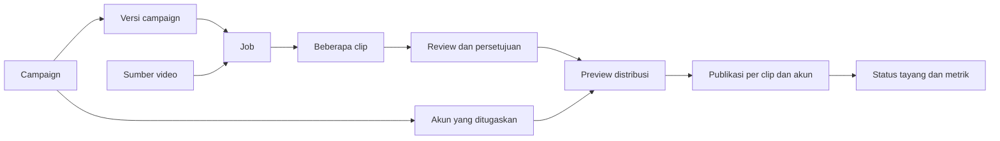
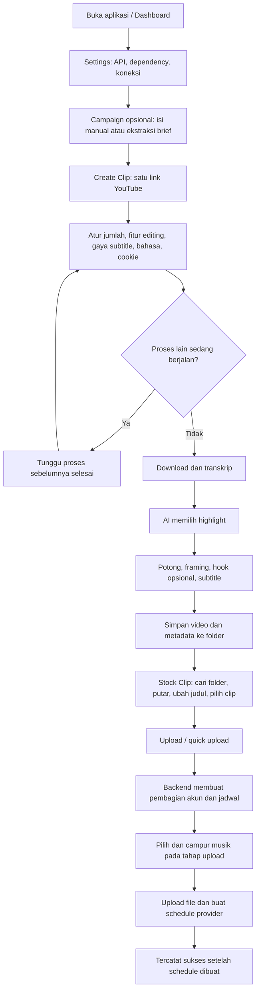
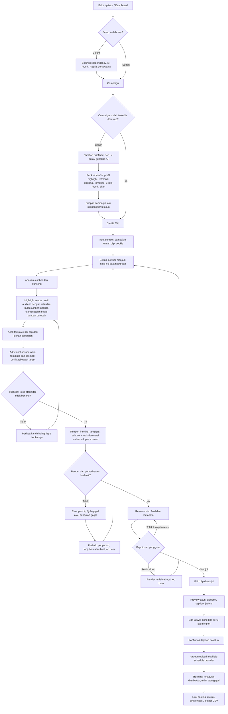
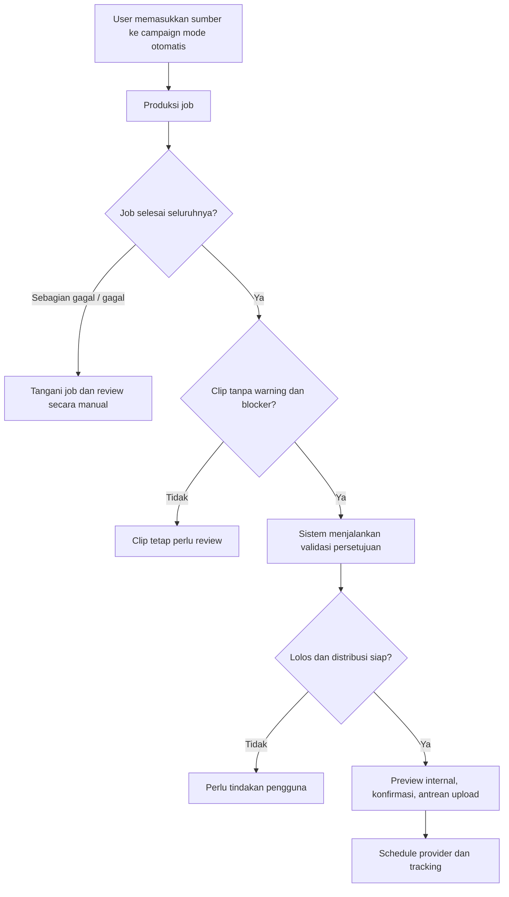

# SSR_CLIPPER — user flow sebelum dan sekarang

Dokumen kerja UI/UX · diperbarui 28 September 2026

## Cara membaca

- **Sebelum:** baseline kode Git `a5ce5f6` — `musik update`, 4 September 2026. Ini baseline tersimpan sebelum rangkaian upgrade di working tree, bukan rekaman setiap kondisi aplikasi yang pernah dibuka. Perubahan lokal lama yang tidak tercatat Git tidak bisa direkonstruksi persis.
- **Sekarang:** kode working tree setelah upgrade hingga 28 September 2026, termasuk profil Highlight Finder campaign, empat template bawaan, dan integrasi template Kdenlive/MLT. Pemetaan berdasarkan handler UI, bridge Python, layanan, dan tes; aplikasi/GUI tidak dioperasikan untuk audit ini.
- **Usulan:** gagasan untuk desain berikutnya, belum menjadi perilaku aplikasi.
- **Tersedia** berarti ada jalur implementasi; bukan jaminan semua model AI, akun provider, dan format media telah diuji nyata.

Inventaris rinci ada di [FEATURE_INVENTORY.md](FEATURE_INVENTORY.md). Dokumen ini menjelaskan perjalanan pengguna, hubungan fitur, status, dan konsekuensi keputusan desain.

## 1. Perubahan model produk

**Sebelum:** pengguna mengonfigurasi satu proses clipping, menghasilkan file, lalu mengirim file dari Stock Clip. Campaign sudah ada, tetapi belum mengendalikan seluruh produksi.

**Sekarang:** pengguna menyimpan campaign sebagai aturan produksi yang dapat dipakai ulang, membuat beberapa pekerjaan dari sumber video, menilai hasil final, kemudian mengirim paket publikasi dan memantau statusnya.

Pembagian tanggung jawab:

| Pengguna | Sistem | Layanan di luar aplikasi |
| --- | --- | --- |
| Mencari dan memilih campaign | Membaca brief menjadi usulan data | Website penyedia campaign |
| Memilih sumber, akun, template yang boleh dipakai, dan bobot | Mencari highlight, mengacak template, memproses video dan metadata | Penyedia AI dan musik |
| Mengoreksi brief, menilai hasil, menyetujui, menyesuaikan jadwal | Mengantrekan produksi/publikasi, memvalidasi, mengirim, menyinkronkan | Repliz dan platform sosial |
| Memantau hasil konten | Menampilkan status dan metrik yang tersedia | Pembayaran/pendapatan tetap di luar sistem |

**Batas penting:** campaign discovery, klaim campaign, pembayaran, dan pencairan uang tidak menjadi alur aplikasi. Mode otomatis tidak mencari campaign atau sumber video sendiri.

## 2. Peta objek yang perlu dipahami sebelum mendesain

| Objek | Makna untuk pengguna | Hubungan penting |
| --- | --- | --- |
| Campaign | Paket brief, aset, aturan editing, template, dan akun yang ditugaskan | Dipakai berulang oleh banyak job |
| Versi campaign | Salinan aturan saat pekerjaan dibuat | Edit campaign tidak mengganti aturan job yang sudah mengantre |
| Akun | Identitas tujuan publikasi dari Repliz | Satu lingkup audiens; bisa dipakai beberapa campaign yang cocok |
| Jadwal akun | Jam upload rutin dan batas harian | Milik akun secara global, meskipun diedit dari halaman campaign |
| Sumber | Link video atau file lokal panjang | Bisa menghasilkan banyak clip; berbeda dari aset sisipan campaign |
| Job / pekerjaan | Satu permintaan produksi dari satu sumber | Beberapa sumber berarti beberapa job; bukan satu job per clip |
| Clip | Satu hasil video beserta metadata dan status review | Memiliki template yang sudah dipilih dan rentang sumber |
| Revisi metadata | Versi judul/caption/persetujuan | Perubahan metadata perlu persetujuan baru |
| Render revisi | Produksi ulang clip dengan perubahan yang diizinkan | Menjadi job dan hasil baru; hasil lama tetap ada |
| Preview distribusi | Rencana sementara akun, caption, dan jadwal | Dapat diedit sebelum dikonfirmasi; kedaluwarsa setelah 15 menit |
| Publikasi | Pengiriman satu clip ke satu akun pada suatu waktu | Statusnya terpisah dari status produksi dan review |



Satu clip belum berarti satu posting. Clip bisa selesai dirender tetapi belum direview, sudah disetujui tetapi belum dijadwalkan, atau sudah terjadwal tetapi belum tayang.

## 3. User flow SEBELUM



### Langkah dan batas alur lama

| Tahap | Aksi pengguna | Respons sistem / batas |
| --- | --- | --- |
| Setup | Mengisi API dan koneksi, memeriksa dependency | Settings umum; belum ada onboarding terpandu |
| Campaign | Membuat campaign, mengisi data/brief, memilih akun | Sudah ada ekstraksi brief; penggunaan campaign pada produksi belum mencakup seluruh aturan/aset |
| Create Clip | Memasukkan satu URL; memilih jumlah atau mode AI; mengatur fitur | Setelan produksi tersebar antara Create Clip dan Settings |
| Menjalankan | Menekan Create Clip | Hanya satu pekerjaan sumber aktif; belum dapat menaruh sumber berikutnya dalam antrean persisten |
| Produksi | Mengikuti progress global, clip, dan log | Clip dalam satu pekerjaan sudah dapat diproses paralel; paralel bukan fitur yang baru muncul sekarang |
| Hasil | Membuka Stock Clip berbasis folder, putar video, ubah judul/hapus | Belum ada lifecycle review pending/approved/rejected yang mengikat file dan caption |
| Upload | Memilih clip lalu menekan upload | UI menggunakan quick upload; fungsi preview backend tidak menjadi layar persetujuan terpisah pada jalur ini |
| Musik | Tidak menilai campuran musik final sebelum persetujuan khusus | Musik dipilih/dicampur saat konfirmasi upload; kegagalan dapat jatuh kembali ke file asli |
| Hasil upload | Melihat status sukses/gagal lokal | Schedule berhasil dibuat dapat langsung dianggap sukses; belum membuktikan konten tayang |

**Implikasi UX lama:** pekerjaan berpusat pada file dan satu proses aktif. Pengguna belum memiliki satu rangkaian status yang konsisten dari produksi sampai benar-benar terbit. Video yang sempat diputar sebelum upload belum tentu sama dengan video setelah penambahan musik.

## 4. User flow SEKARANG — jalur manual utama



### 4A. Setup pertama kali

1. Aplikasi membuka Dashboard. Belum ada wizard onboarding.
2. Pengguna membuka Settings untuk memasang/memeriksa dependency dan konfigurasi layanan.
3. Provider/model/key diatur sesuai tugas: highlight, caption, brief, analisis konten/musik; hook/TTS masih tersedia pada Settings tetapi empat template bawaan mematikan hook.
4. Musik otomatis memerlukan layanan musik yang tersedia; pilihan alternatif adalah file musik lokal pada campaign.
5. Akun publikasi berasal dari Repliz. Koneksi diperlukan untuk distribusi, bukan untuk sekadar menyimpan draft campaign.
6. Zona waktu default WITA (`Asia/Makassar`) dan jam AM/PM. Penggantian zona berada di Settings.

**Kesiapan dibedakan:** siap produksi tidak otomatis berarti siap distribusi. Aset dapat lengkap tetapi akun belum cocok/tersambung; API atau sumber juga masih dapat gagal ketika benar-benar dipakai.

### 4B. Membuat / mengubah campaign

1. Pengguna memilih campaign dari website luar, lalu membuka Campaign → Create Campaign.
2. Isi nama/status atau masukkan brief dan konteks. Bisa manual tanpa AI.
3. Tambahkan beberapa file, tentukan peran: brief, video campaign, musik, penutup, gambar, atau B-roll; tandai aset sisipan wajib. B-roll tidak menjadi sisipan wajib.
4. Jika memakai AI: baca brief → usulan data + sumber + informasi kurang/konflik.
5. Pengguna memeriksa dan menyelesaikan konflik. Data yang belum diketahui tidak otomatis dianggap benar.
6. Atur lingkup audiens, bahasa, platform, rentang durasi, hashtag/CTA, tujuan, persona, angle, hook referensi, Do/Don't dan aturan umum. Pada **Tag akun**, pilih TikTok atau Instagram lalu isi mention khusus sosmed itu. Berpindah pilihan mempertahankan dua daftar yang terpisah.
7. Isi **Profil Highlight** atau tambah contoh video opsional → **Buat usulan profil** → tinjau → **Terapkan usulan ke form**. Profil tetap bisa diisi manual. Aktifkan template yang boleh digunakan dan bobot peluang masing-masing. Lihat fitur dan contoh visual template; Sinematik memerlukan aset B-roll. [Profil dan finder campaign](CAMPAIGN_HIGHLIGHT_FINDER.md), [dua template referensi](TEMPLATE_TIMOTHY_REFERENCES.md).
8. Atur framing, sumber sebagai materi campaign/eksternal, proporsi eksternal, musik, penutup, worker, serta review manual/otomatis. Di kartu **Additional**, pilih watermark atau foto wajah target, rasio output, sosmed, dan aturan template. Watermark dapat memuat beberapa gambar sekaligus; geser/ubah ukuran masing-masing, atau hapus melalui ikon sampah di kiri atas gambar. Lihat [alur Additional](CAMPAIGN_ADDITIONALS.md).
9. Pilih akun tujuan yang relevan, lalu **Simpan campaign**.
10. Pada akun, isi jam upload dan maksimum per hari → **Simpan jadwal akun**. Audiens/bahasa diambil dari campaign yang sudah disimpan.

**Efek edit:** perubahan campaign berlaku bagi job berikutnya. Resume job lama masih memakai salinan campaign ketika job dibuat. Jadwal akun adalah pengaturan akun bersama; mengeditnya dari satu campaign juga memengaruhi perencanaan campaign lain yang memakai akun tersebut.

### 4C. Membuat dan memantau job

| Input / keputusan | Perilaku sekarang |
| --- | --- |
| Sumber | Satu sumber per baris; link YouTube atau file lokal. File picker mendukung MP4/MOV/MKV/WebM; label tombol masih “MP4 lokal” |
| Banyak sumber | Maksimal 50 sumber dalam satu permintaan; masing-masing menjadi satu job |
| Campaign | Wajib; pilih campaign aktif. Ringkasan template dan blocker tampil di form |
| Jumlah clip | 1–100 per sumber atau AI menentukan. Jumlah diminta adalah target, bukan jaminan memaksa highlight buruk |
| Cookie | Opsional sesuai kebutuhan autentikasi; file tersimpan dapat dipakai kembali |
| Setelah Create Clip | Input terbuka lagi setelah permintaan diterima; dapat menambahkan job saat job lain masih berjalan |
| Antrean | Job sumber berjalan bergiliran; clip dalam job dapat paralel dengan batas worker campaign |
| Judul job | Nama file lokal atau judul link yang dimuat di latar. Gagal membaca judul tidak otomatis membatalkan job |
| Sebelum highlight ditemukan | Tampil tahap persiapan; jumlah hasil belum diketahui |
| Sesudah highlight ditemukan | Jumlah clip, selesai/total, sedang dikerjakan, menunggu, gagal, progress tahap, dan log per job |
| Kontrol | Jeda untuk job yang masih antre; batalkan job antre/berjalan; lanjutkan job gagal/sebagian gagal/terhenti/dibatalkan/dijeda |

### 4D. Produksi di belakang layar

1. Periksa sumber dan identitas file → download atau gunakan file lokal/cache.
2. Gunakan transkrip bertimestamp; fallback transkripsi jika diperlukan. Sumber visual tanpa transkrip dapat memakai analisis sampel gambar.
3. AI memilih kandidat sesuai profil highlight campaign: audiens, tujuan, topik, sudut, pembuka, larangan, konteks wajib, bobot, dan nilai minimum. Kandidat boleh saling overlap; pilihan memiliki nilai per dimensi serta kutipan sumber bertimestamp.
4. Periksa batas sumber, durasi, dan akhir ucapan. Akhir dapat diperpanjang sampai jawaban selesai selama masih muat di rentang campaign; tidak ada target wajib 30 detik. Rentang yang berubah diperiksa kembali terhadap profil; hasil akhir diurutkan berdasarkan nilai sesudah pemeriksaan sebelum kuota dipenuhi.
5. Pilih template secara acak berbobot **untuk setiap clip**. Ini pemilihan acak berdasarkan bobot, bukan AI yang mengukur template mana paling cocok atau paling banyak views.
6. Terapkan filter foto target sesuai rasio, pilihan template, serta sosmed tujuan; kandidat gagal dilewati sampai kuota terpenuhi atau kandidat valid habis. Bentuk rencana editing → potong/framing → sisipan/penutup → layout/subtitle → musik → versi watermark per sosmed → pemeriksaan audio dan metadata final. Review menyediakan preview setiap versi; distribusi memilih file yang sesuai platform akun.
7. Musik wajib berhasil dipasang. Bagian lagu yang hening, file hilang, atau kegagalan auto music menyebabkan error; clip itu belum dinyatakan selesai.
8. Simpan video final, rencana, sumber, pilihan template, caption, pemeriksaan, serta identitas hasil untuk review.

Tidak ada editor timeline bebas pada UI. Sistem belum menyusun cerita bebas lintas beberapa sumber hanya karena dapat menerima beberapa job.

### 4E. Review dan revisi

1. Buka Review & Upload → Review clip, atau pintasan dari campaign/dashboard.
2. Cari judul/filter status. Pilih Review pada satu clip.
3. Putar video final yang sudah mengandung musik.
4. Periksa judul, caption publikasi, caption per platform, blocker/peringatan, pengukuran audio, dan rencana editing/sumber. Alasan/nilai/bukti highlight tersedia; penilaian cocok, di luar topik, perlu konteks, atau akhir belum selesai dapat disimpan terpisah dari persetujuan.
5. Pilih tindakan:
   - **Simpan revisi:** menyimpan metadata dan mengembalikan status ke perlu review.
   - **Tolak:** clip tetap tersimpan dengan status ditolak; ini bukan menghapus file.
   - **Setujui clip:** memvalidasi judul/caption, kewajiban hashtag/mention/CTA, blocker, serta kecocokan file.
   - **Render revisi:** ubah framing/musik → job baru → hasil baru perlu review manual. Template hasil yang sudah dipilih tetap dipertahankan; tidak diacak ulang.
6. Hanya clip yang disetujui dapat dicentang untuk distribusi.

Mengedit caption publikasi tidak mengedit subtitle yang dibakar pada video. Clip lama tanpa informasi sumber/rencana lengkap tidak selalu bisa dirender ulang; dapat membutuhkan job baru dari sumber.

### 4F. Distribusi dan tracking

1. Pilih clip disetujui → Preview distribusi.
2. Sistem memeriksa akun yang ditugaskan, koneksi, lingkup audiens/bahasa, platform campaign, kuota dan overlap.
3. **Satu clip dipetakan ke satu akun tujuan pada satu preview.** Akun dipilih menurut slot tersedia dan beban; belum ada fan-out satu clip ke semua platform dalam satu tindakan.
4. Jam diambil dari daftar jam akun dan kuota lintas campaign/batch. Batas lima dengan dua slot jam tetap menghasilkan paling banyak dua slot rutin per hari.
5. Pengguna melihat akun/platform/caption. Di kolom Jadwal dapat mengganti tanggal dan jam AM/PM → Simpan jadwal.
6. Jadwal inline boleh berbeda dari jam rutin akun, tetapi tetap harus di masa depan dan lolos kuota/bentrok. Akun tujuan tidak memiliki editor manual pada tabel sekarang.
7. Upload paket ini memvalidasi ulang file, review, akun, kuota, timezone, dan usia preview; lalu mereservasi publikasi dalam transaksi.
8. Worker mengunggah file final dan membuat schedule Repliz. Berhasil membuat schedule berarti **terjadwal**.
9. Tracking menyinkronkan status provider → sedang diterbitkan → terbit/gagal; link dan metrik ditampilkan ketika tersedia. Dapat sinkron manual dan ekspor CSV.

**Setelah dikirim ke provider:** UI saat ini belum menyediakan pengeditan ulang tanggal/jam publikasi. Tombol Batalkan hanya muncul pada antrean/kegagalan yang belum punya schedule provider dan tidak ambigu. Ketidakpastian pengiriman meminta perhatian/rekonsiliasi, bukan pengiriman ulang membabi buta.

## 5. Cabang mode otomatis yang sudah ada

Mode awal tetap manual. Pengguna dapat memilih mode otomatis pada campaign.



- Pemicu otomatis berasal dari job yang selesai, bukan pemantauan website campaign atau jadwal pencarian sumber.
- Clip yang memiliki warning/blocker tidak otomatis disetujui. Tidak semua pemeriksaan mutu narasi/visual bisa dibuktikan oleh kode.
- Render revisi selalu kembali ke review manual, sekalipun campaign aslinya otomatis.
- Produksi dan upload lokal memerlukan aplikasi/worker hidup. Schedule yang sudah diterima provider mengikuti layanan provider.

## 6. Status dan recovery yang perlu tercermin dalam desain

| Objek | Status utama | Aksi/pemulihan yang relevan |
| --- | --- | --- |
| Campaign | Draft, aktif, arsip | Lengkapi/aktifkan; status “siap produksi” dan “siap distribusi” merupakan hasil pemeriksaan terpisah |
| Job | Antre → berjalan → selesai | Lihat progress per sumber; hasil dapat terdiri dari beberapa clip |
| Job bermasalah | Sebagian gagal, gagal, terhenti, dijeda, membatalkan, dibatalkan | Lanjutkan yang diizinkan; perbaikan konfigurasi campaign membutuhkan job baru agar snapshot baru dipakai |
| Clip dalam produksi | Menunggu, berjalan, selesai, error, dibatalkan | Lihat error per clip; satu clip gagal tidak otomatis menghapus hasil lainnya |
| Review clip | Perlu review, disetujui, ditolak | Simpan revisi, setujui, tolak, render revisi |
| Preview | Belum disimpan, menyimpan, valid, error, kedaluwarsa | Simpan tiap edit; buat preview ulang jika policy berubah atau masa berlaku habis |
| Publikasi lokal | Antre, uploading | Bisa batalkan sebelum pengiriman sesuai status; file tetap terkait persetujuan |
| Publikasi provider | Terjadwal, sedang diterbitkan, terbit | Sinkron status; jadwal terbuat tidak sama dengan tayang |
| Publikasi bermasalah | Gagal, perlu perhatian, dibatalkan | Coba lagi jika hasil pengiriman jelas; rekonsiliasi jika ambigu |
| Metrik | Tersedia, belum tersedia, gagal sinkron | Jangan tampilkan “0 views” ketika datanya belum ada |

### Cabang kegagalan yang perlu didesain

| Kejadian | Perilaku sekarang | Tempat pengguna bertindak |
| --- | --- | --- |
| Brief bertentangan | Nilai konflik ditampilkan; keputusan user dipertahankan | Campaign: pilih nilai form atau usulan |
| Aset wajib hilang | Campaign/produksi tertahan | Campaign: tambahkan/ganti aset dan simpan |
| Akun tidak cocok atau terputus | Distribusi ditolak dengan alasan | Campaign / layanan akun Repliz |
| Tidak ada highlight utuh | Kandidat dilewati; dapat menghasilkan lebih sedikit clip atau job gagal | Periksa sumber/rentang durasi, buat job baru |
| Musik tidak tersedia/hening | Render clip gagal | Coba ulang layanan atau gunakan musik lokal pada job baru/revisi |
| Pembicara tidak pasti | Framing dapat menampilkan frame utuh, dengan warning | Review video, lalu revisi framing bila perlu |
| Aplikasi berhenti | Pekerjaan yang aktif dipulihkan sebagai terhenti | Pekerjaan → Lanjutkan |
| Video berubah setelah review | Persetujuan/file ditolak | Muat ulang video lalu review kembali |
| Jadwal bentrok atau kuota terlampaui | Edit ditolak; jadwal tersimpan sebelumnya tetap utuh | Kolom Jadwal atau preview baru |
| Zona/jadwal akun berubah | Preview lama tidak boleh dikonfirmasi | Buat preview distribusi baru |
| Timeout sesudah submit | Publikasi berstatus perlu perhatian | Sinkronkan/periksa provider sebelum retry |

## 7. Kepemilikan pengaturan dan efek perubahan

| Diatur di | Pengaturan | Berlaku untuk | Kapan perubahan berlaku |
| --- | --- | --- | --- |
| Settings | Provider, model, key, dependency, GPU/detector, watermark, folder output | Aplikasi | Dibaca sesuai tahap eksekusi; bukan seluruhnya dibekukan dalam snapshot job |
| Settings | Zona waktu | Penjadwalan dan tampilan waktu seluruh akun | Preview lama perlu dibuat ulang; waktu tayang absolut publikasi tersimpan tidak digeser |
| Campaign | Brief, bahasa/audiens, template aktif dan bobot, musik, framing, penutup, mode review, worker | Produksi campaign | Job baru; job lama memakai salinan aturan awal |
| Campaign → akun | Jam rutin dan maksimum upload | Akun yang sama lintas campaign | Perencanaan berikutnya; perubahan membatalkan validitas preview lama |
| Create Clip | Sumber, campaign, jumlah clip | Job yang dibuat | Saat job masuk antrean |
| Create Clip | Cookie | Kredensial pengambilan sumber yang disimpan bersama | Digunakan kembali; bukan cookie berbeda yang dikelola per baris job |
| Review clip | Judul, caption umum/per platform | Clip/revisi itu | Simpan kembali memerlukan persetujuan baru |
| Render revisi | Framing dan musik | Job revisi/hasil baru | Video lama tidak ditimpa; template tetap |
| Preview distribusi | Tanggal dan jam satu baris | Publikasi yang direncanakan itu | Setelah Simpan jadwal; tidak mengubah jam rutin akun |

## 8. Perbandingan ringkas

| Aspek | Sebelum | Sekarang |
| --- | --- | --- |
| Unit kerja utama | Proses sumber dan folder file | Campaign → job → clip → publikasi |
| Create Clip | URL dan banyak pengaturan produksi | Empat kelompok input |
| Sumber lokal/batch | Jalur utama satu URL YouTube | URL + video lokal, beberapa sumber |
| Pekerjaan bersamaan | Satu sumber aktif; tunggu untuk berikutnya | Bisa memasukkan banyak job; eksekusi sumber bergiliran |
| Paralel clip | Sudah ada | Tetap ada, worker dibatasi per campaign |
| Brief | Ekstraksi satu bahan, struktur campaign lebih sederhana | Beberapa file, peran aset, sumber usulan, konflik, readiness |
| Aturan produksi | Campaign terutama memengaruhi ID dan durasi | Snapshot campaign ikut rencana editing dan pemeriksaan |
| Template | Gaya subtitle/toggle di Create Clip | Dua paket editing tetap, aktivasi dan bobot per campaign |
| Acak template | Belum ada pool template per campaign | Acak berbobot per clip, pilihan disimpan |
| Akhir ucapan | Timestamp AI terutama menjadi batas potong | Penyesuaian akhir berdasar transkrip/jeda dan rentang campaign |
| Musik | Diproses saat upload; bisa kembali ke video tanpa musik | Wajib selesai di produksi sebelum review |
| Review | Putar/edit file; belum ada gerbang approval formal | Pending/approved/rejected, video final, caption, pemeriksaan |
| Revisi | Edit judul/file; belum workflow rerender persisten | Revisi metadata dan render revisi sebagai job |
| Akun | Penugasan campaign | Penugasan + kecocokan audiens/bahasa + jadwal/kapasitas akun |
| Distribusi | Quick upload, planner internal | Preview wajib pada mode manual sebelum confirm |
| Jadwal | Dibuat oleh logika backend | Jam akun + editor tanggal/jam inline |
| Kuota | Perhitungan batch lebih terbatas | Lintas batch/campaign dan reservasi transaksional |
| Terbit | Schedule diterima dapat dicatat sukses | Scheduled/publishing/published dibedakan |
| Tracking | Riwayat/status lokal | Rekonsiliasi provider, link, metrik, CSV |
| Pemulihan | Progres pekerjaan tidak menjadi antrean persisten | Simpan job, resume, cache, deteksi hasil selesai |
| Otonomi | Banyak aksi per proses/upload | Mode manual utama + otomatis bersyarat per campaign |

## 9. Struktur halaman saat ini

```text
Dashboard
  Ringkasan akun/campaign/clip, progress pekerjaan, dependency, pintasan
Campaign
  Daftar → Create/Edit
    Identitas, brief/aset, aturan, editing, template, akun + jadwal
Create Clip
  Empat input + daftar job + detail progress/log/clip
Review & Upload
  Review clip → Detail review → Render revisi
  Preview distribusi → Edit jadwal → Konfirmasi
  Pekerjaan
  Tracking
Settings
  Integrasi/AI, dependency, global time, output, watermark, framing engine
```

### Temuan nyata yang penting untuk redesign

1. **Job muncul di tiga tempat:** Dashboard, Create Clip, dan tab Pekerjaan. Detail/kontrolnya tidak seragam.
2. **Satu halaman campaign memuat banyak tanggung jawab:** brief, aset, konfigurasi produksi, akun, dan jadwal akun global.
3. **Ada dua tahap simpan:** campaign dahulu, kemudian jadwal tiap akun. Status “campaign tersimpan” tidak berarti semua perubahan jadwal sudah disimpan.
4. **Pintasan Stok dan Upload pada kartu campaign menuju view review yang sama.** Label masih menyiratkan dua tujuan berbeda.
5. **Settings menyimpan kontrol legacy.** Contohnya hook/TTS masih terlihat, tetapi empat template bawaan mematikan Hook Maker. Tampilkan konteks kapan kontrol berpengaruh.
6. **Istilah caption punya dua arti:** subtitle dalam video dan caption posting. Nama/kelompok UI sebaiknya membedakan keduanya dengan tegas.
7. **Jumlah clip sebelum dan sesudah analisis berbeda makna:** target diminta vs kandidat yang lolos vs hasil berhasil. Jangan menyatukan tiga angka ini.
8. **Jadwal, review, dan produksi adalah status yang berbeda.** Satu badge “Selesai” tidak cukup untuk seluruh perjalanan konten.
9. **Log teknis belum seluruhnya mengikuti formatter waktu UI.** Jadwal/tracking/CSV sudah memakai zona global; log job masih dapat menampilkan timestamp mentah. Ini ketidakkonsistenan aktual, bukan pengaturan timezone per akun.
10. **Beberapa kemampuan lama tidak punya UI aktif:** komponen Stock Clip lama masih di repository, tetapi ditimpa oleh komponen Review & Upload saat halaman dimuat. Jangan menganggap semua tombol di file lama masih tersedia.

## 10. Arah pengorganisasian berikutnya — USULAN, belum diterapkan

Tujuannya memberi satu rumah utama untuk setiap objek, sambil mempertahankan empat input Create Clip yang sudah disepakati.

| Rumah utama yang disarankan | Isi | Alasan |
| --- | --- | --- |
| Overview | Ringkasan antrean, perlu review, gagal/perlu perhatian, jadwal mendatang | Jawab “apa yang perlu saya kerjakan sekarang?” |
| Campaign | Brief, aset, template/peluang, aturan, akun yang ditugaskan | Pusat instruksi produksi yang dipakai ulang |
| Produksi | Create Clip + antrean + detail job | Satu tempat melihat proses dan memulihkan kegagalan |
| Konten | Hasil clip, review, metadata, revisi | Pisahkan hasil dari pekerjaan yang membuatnya |
| Publikasi | Rencana distribusi, jadwal, status provider, tracking | Pisahkan approval konten dari pengiriman |
| Pengaturan | Integrasi, zona global, mesin render, penyimpanan | Kurangi parameter teknis di alur harian |

Bagian akun/jadwal tetap dapat dibuka dari campaign sesuai permintaan pengguna. Jika kelak dibuat manajemen akun terpusat, tampilkan bahwa datanya **dibagikan lintas campaign**, bukan salinan profil untuk setiap campaign.

Prioritas desain yang paling membantu:

1. Tetapkan istilah dan status objek lebih dahulu.
2. Tetapkan kepemilikan serta lingkup setiap pengaturan.
3. Tentukan satu halaman utama untuk job, clip, dan publikasi.
4. Desain jalur normal sekaligus empty/loading/partial/error/recovery.
5. Bedakan tindakan **simpan**, **setujui**, **antrekan**, **kirim ke provider**, dan **terbit**.
6. Baru susun layout, komponen visual, dan detail interaksi.

## 11. Batas kemampuan yang jangan dianggap sudah tersedia

- Identitas piksel 100% template video referensi belum terbukti; font masih pendekatan.
- Belum ada pembuat template visual, editor timeline bebas, editor kata/timing subtitle, trim manual per clip, atau penggabungan cerita bebas lintas sumber di UI aktif.
- Belum ada janji semua narasi pasti utuh; transkrip, tanda baca, jeda, serta pilihan AI masih perlu review.
- Belum ada satu tombol yang otomatis menerbitkan setiap clip ke semua platform.
- Belum ada perubahan jadwal provider yang sudah dikirim melalui editor inline saat ini.
- Belum ada OCR PDF hasil scan sebagai jalur penuh, auto-discovery campaign, sistem pembayaran, atau mesin produksi yang terus hidup saat aplikasi ditutup.
- Beberapa fitur ada di backend/legacy tetapi belum memiliki jalur UI aktif; lihat inventaris agar tidak dimasukkan sebagai fitur siap pakai.

## 12. Dua sistem: authoring template dan produksi clip

[Percakapan tentang editor video open source](https://chatgpt.com/share/6ab5f380-7764-83ec-a02a-3ce1ad376563) menambahkan kebutuhan authoring template. Instruksi terbaru menetapkan pemisahan sistem authoring dan clipping; pilihan yang diimplementasikan adalah **Kdenlive + paket render MLT**. Detail kontrak dan batas kompatibilitas ada di [TEMPLATE_SYSTEMS.md](TEMPLATE_SYSTEMS.md).

**Posisi fitur sekarang:** empat preset bawaan tersedia, termasuk Tegas 4:3 dan Sinematik 16:9; Sinematik memakai aset berperan B-roll. Template visual tambahan dapat disusun di Kdenlive, diekspor melalui toolkit terpisah, lalu diimpor ke campaign dan diberi bobot. SSR memakai salinan timeline/aset beserta runtime MLT sendiri. `Render revisi` tidak membuka editor visual dan belum ada round-trip timeline untuk hasil satu clip.

Alur authoring berada **sebelum campaign**:

```mermaid
flowchart LR
  A[Desain di Kdenlive — sistem 1] --> B[Export render MLT]
  B --> C[Toolkit membuat paket template versi tertentu]
  C --> D[SSR mengimpor salinan paket — sistem 2]
  D --> E[Campaign mengaktifkan template dan bobot]
  E --> F[Job merender melalui MLT tanpa editor]
  F --> G[Subtitle + musik wajib + QA]
  G --> H[Review video final]
  H --> I[Distribusi + tracking]
```



UI perlu membedakan **membuat template di aplikasi authoring**, **mengimpor/memakai template dalam campaign**, dan **review/revisi satu hasil**. Komposisi MLT sudah diuji tanpa folder authoring. Kompatibilitas versi awal terbatas pada kontrak yang didokumentasikan; project/efek Kdenlive arbitrer belum bisa diimpor langsung.

## 13. Sumber pemeriksaan

- Baseline: `git show a5ce5f6:web/app.js`, `web/components/home.js`, `web/components/stock-clip.js`, `web/campaigns.js`, `app.py`, `clipper_core.py`.
- Jalur UI aktif: [index.html](../web/index.html), [header.js](../web/components/header.js), [app.js](../web/app.js), [campaign-workspace.js](../web/campaign-workspace.js), [workflow-review.js](../web/components/workflow-review.js).
- Kontrak campaign/template: [campaigns.py](../services/campaigns.py), [template_selection.py](../services/template_selection.py).
- Produksi: [core_workflow.py](../services/core_workflow.py), [speech_boundaries.py](../services/speech_boundaries.py), [editing.py](../services/editing.py), [framing.py](../services/framing.py).
- Review, pekerjaan dan otomasi: [workflow.py](../services/workflow.py), [storage.py](../services/storage.py).
- Jadwal/publikasi: [publishing.py](../services/publishing.py), [scheduling.py](../services/scheduling.py), [time.js](../web/time.js).
- Batas verifikasi dan backlog: [IMPLEMENTATION_STATUS.md](IMPLEMENTATION_STATUS.md). Rencana lama [UPGRADE_PLAN.md](UPGRADE_PLAN.md) adalah catatan target historis; jika berbeda, kode aktif dan dokumen audit ini menjadi acuan perilaku saat ini.
