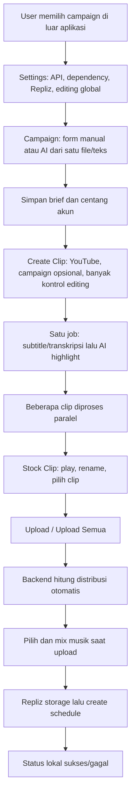

# Audit baseline user flow — sebelum upgrade percakapan

Tanggal audit: 24 September 2026. Baseline yang dapat dibuktikan dari Git: **`a5ce5f6cde54a5f9864556fd75bd27bc0ed65b9a` (`musik update`)**. Semua rujukan kode di dokumen ini menunjuk isi file pada commit tersebut, bukan working tree saat ini. Pemeriksaan dilakukan melalui `git show`; aplikasi/GUI tidak dijalankan dan konfigurasi pengguna tidak dibaca.

## 1. Batas pembanding

- Ini rekonstruksi implementasi sebelum upgrade berdasarkan commit terakhir yang tersedia. Desain, permintaan user, dan rencana upgrade tidak otomatis dianggap fitur yang sudah berjalan.
- Baseline sudah memiliki campaign, AI extraction, parallel rendering beberapa clip, metadata, serta upload Repliz. Perubahannya bukan dari aplikasi yang sama sekali belum punya otomasi.
- `docs/UPGRADE_PLAN.md`, bagian “Baseline sebelum upgrade”, sejalan dengan temuan kode: musik pada tahap konfirmasi upload; schedule langsung disebut sukses; scheduler dinonaktifkan; belum ada antrean pekerjaan persisten.

## 2. Peta halaman baseline

Navigasi sidebar: **Dashboard → Campaign → Create Clip → Stock Clip → Settings**. Campaign Edit merupakan subhalaman Campaign. Tidak ada halaman Review & Upload atau Tracking terpisah.

Bukti: `web/components/header.js:Shell`, `web/app.js` pembuatan view dan `setActiveView`.

### Settings / persiapan

1. Memeriksa dependency (yt-dlp, FFmpeg, Deno, Whisper) dan menekan Install All bila diperlukan.
2. Memasukkan API key provider: OpenAI, Gemini, atau sampai tiga custom endpoint/provider.
3. Memilih/menguji model untuk Highlight Finder, Caption Maker, Hook Maker, YT Title Maker, Brief Extractor; memilih Whisper lokal/API dan Reload Model.
4. Memasukkan key Repliz, Test Connection, memuat akun TikTok/YouTube/Instagram. Pengelolaan/koneksi akun melalui layanan Repliz; dashboard Repliz bisa dibuka.
5. Opsional: mengatur watermark gambar (file, posisi, skala, opacity), credit nama channel (posisi, ukuran, opacity), dan gaya opening hook (font, warna, background, ukuran, radius, posisi).
6. Memilih face tracking OpenCV/MediaPipe, GPU on/off dan Detect GPU; memilih/membuka output folder.
7. Tersedia juga Connect/Disconnect YouTube OAuth sebagai integrasi langsung, tetapi alur bulk upload Stock Clip memakai Repliz.
8. Save Settings atau autosave dari perubahan field.

Bukti: `web/components/ai-settings.js:AiSettingsView`, `web/app.js:persistAiSettings`, `validateAndLoad`, `testModelReadiness`, `loadReplizData`; `app.py` API terkait settings/YouTube.

Tidak ada pengaturan timezone global atau profil akun berisi genre/jadwal/kuota. Pemilihan musik Jamendo sudah ada di backend tetapi belum merupakan editing campaign / tahap produksi yang di-review.

### Dashboard

- Ringkasan jumlah campaign, akun per platform, clip yang ditemukan, penggunaan storage, dependency.
- Daftar campaign, stock clip, job aktif/riwayat sesi, pintasan output folder dan Repliz Dashboard.
- Ini ringkasan operasional lokal, belum dashboard performa views/likes/post URL dari konten terbit.
- Tombol Restock menampilkan “Fitur belum tersedia”. Pencarian global, wallet, notifikasi disembunyikan dengan TODO. `totalModels=4` statis di backend. Beberapa angka contoh akun/campaign ada di markup awal sebelum refresh data.

Bukti: `web/components/dashboard.js:DashboardView/refresh`, `app.py:get_dashboard_stats` (1305–1330), `get_account_stats` (576–616), `web/components/header.js`.

### Campaign / Campaign Edit

1. User memilih campaign di website di luar aplikasi.
2. Campaign → Create Campaign.
3. Isi manual atau AI Quick-fill: paste teks lalu Create brief; atau pilih **satu file** PDF/DOCX/gambar, ekstraksi langsung diterapkan ke form.
4. User mengoreksi nama, status Active/Archived, durasi min/max, maks clip per akun/hari, hashtags, tagged accounts, daftar hook, catatan, angles, persona, tujuan, CTA, Do, Don't, Aturan Umum (judul+deskripsi).
5. Centang akun Repliz yang dikaitkan dengan campaign.
6. Save Campaign. Banner bisa diunggah setelah campaign sudah disimpan.
7. Daftar campaign memiliki edit, delete, statistik akun/stock/uploaded, Stok, dan Upload. **Upload campaign dapat langsung memulai quick upload clip yang belum diunggah** ketika Stock Clip di-refresh dengan `autoSelectUnuploaded=true`.

Bukti: `web/campaigns.js:runExtraction`, `applyExtractedBrief`, `populateAccountPicker`, `saveCampaign`, `refreshCampaignList`; `web/components/campaign-edit.js`; `app.py:extract_campaign_brief` (888–950), CRUD campaign.

Keterbatasan: tidak ada gabungan multi-file, provenance per nilai, konflik dokumen, pemeriksaan kesiapan aset wajib, versi/snapshot campaign, pemilihan template per campaign, genre/audiens akun, atau editing jadwal akun. `.doc` dicantumkan pada branch backend bersama `.docx`, tetapi dibaca dengan `python-docx`; jangan mengklaim dukungan binary `.doc` andal.

### Create Clip

Input yang terlihat:

- Link YouTube + Paste (belum picker MP4 lokal).
- Campaign, termasuk pilihan “Tanpa campaign”.
- Highlight Finder on/off + model.
- Caption Maker on/off + model.
- Subtitle Style: V2 Dynamic Word Pop, V3 Kinetic Emphasis, V1 Classic.
- Hook Maker on/off + model.
- YT Title Maker on/off + model.
- Jumlah clip: Fixed number atau AI decides.
- Subtitle Language: Indonesian/English.
- Cookies: tombol dan upload zone.
- Save Default Configuration; Create Clip.

Portrait memiliki toggle pada kode tetapi disembunyikan dan diaktifkan sebagai default. Area tengah sebelum produksi adalah placeholder `9:16`, bukan video preview yang dapat diedit. Panel kanan berisi tahap preparing, clip in-progress/waiting/error, total selesai, progress bar, Program Log dan Copy. Tombol Open Clip Stock menuju hasil.

Bukti: `web/components/home.js:HomeView`, `web/app.js:start`, `lockControls`, `poll`, `renderClipsUI`.

**Satu job sumber aktif saja.** Menekan mulai lagi ketika thread hidup menghasilkan `busy`; UI mengunci konfigurasi ketika memproses. `current_job` dan `job_history` hanya memori. Hasil folder tetap tersimpan, tetapi tidak ada queue sumber persisten/resume per tahap.

Bukti: `app.py:WebAPI.__init__` (210–219), `start_processing` (396–422), `_run` (424–533).

### Proses otomatis baseline

1. Coba mengambil subtitle YouTube terlebih dahulu.
2. Bila tersedia, parse transcript; bila tidak, download video lalu transcribe Whisper.
3. AI mencari dan memberi skor highlight, menyaring durasi min/max, memilih top count / skor minimum.
4. Mengelompokkan highlight overlap dengan conflict group.
5. Download penuh jika cakupan segmen melebihi sekitar setengah video; selain itu download section yang diperlukan.
6. Proses clip paralel dengan **4–7 worker**: potong → portrait/face tracking → opening hook/TTS opsional → subtitle opsional → watermark/credit opsional.
7. Simpan MP4 dan `data.json`: judul, hook, start/end, durasi, fitur yang digunakan, campaign ID, virality score, deskripsi, conflict group, transcript clip. Simpan metadata folder video.

Bukti: `clipper_core.py:process` (616–806), `find_highlights` (2700–2895), `process_clip` (2897–3174).

Keterbatasan penting:

- Full brief belum diteruskan ke pemilihan/editing: `_run` mengambil durasi min/max campaign, `process` meneruskan ID untuk metadata; `find_highlights` menerima transcript, video info, count, score, duration, bukan aturan campaign penuh.
- Toggle Highlight Finder dan YT Title Maker sudah terlihat, tetapi `process` memiliki TODO dan tetap menjalankan `find_highlights`; tidak ada title-generation terpisah yang mengikuti toggle tersebut.
- Tidak ada speech-boundary completion yang memakai jeda/transcript untuk menyelesaikan ucapan setelah end AI.
- Kegagalan masing-masing clip dicatat, tetapi `process` tetap kembali setelah mengumpulkan clip_errors; `_run` dapat melabel job Complete walau beberapa clip gagal.
- Musik belum di-render pada output yang ditonton user di stock.

### Stock Clip / upload

1. Buka Stock Clip atau Stok pada campaign.
2. Panel Jobs berisi **folder sumber video**; pilih folder / All Video / campaign context.
3. Filter clip: semua, belum diupload, terjadwal, uploading, sukses, gagal.
4. Play membuka player lokal; double-click judul untuk rename; hapus clip/folder; buka output folder.
5. Pilih satu/beberapa clip, atau Upload Semua untuk clip belum diupload.
6. Klik Upload memanggil `quick_upload`; tidak ada approval file final atau modal review distribusi yang wajib.
7. Backend mengelompokkan per campaign → `preview_distribution` menghitung akun/jadwal → **langsung** `confirm_distribution`.
8. Pada konfirmasi, AI memilih mood/tempo/volume → Jamendo memilih musik/titik potong → FFmpeg mencampur musik sementara. Bila musik gagal, **tetap upload file asli tanpa musik**.
9. Upload file ke Repliz Storage → buat schedule → simpan scheduled_uploads di metadata lokal.

Bukti: `web/components/stock-clip.js:updateDistributeButton`, handler distribute, `refresh(..., autoSelectUnuploaded)`; `web/components/file-item.js:v3`; `app.py:quick_upload` (1576–1620), `preview_distribution` (1765–1892), `_select_background_sound` (1894–1984), `_mix_music_into_video`, `confirm_distribution` (2102–2241).

Catatan distribusi baseline:

- Caption publikasi dirakit dari CTA+tagged accounts+hashtags campaign, sama untuk semua clip campaign; bukan caption individual berdasarkan isi clip. Judul clip tetap individual dari AI highlight.
- Akun dipilih dari daftar yang dikaitkan campaign, dibagi menurut load pada **batch preview saat itu**; tidak ada profil kesesuaian audiens.
- Jadwal menggunakan jam tetap **09:00 waktu lokal mesin**, naive datetime, lalu diformat dengan akhiran `Z` tanpa konversi UTC yang benar.
- Limit berasal dari campaign (default2); belum memperhitungkan seluruh reservasi batch lain. Tidak ada inline jadwal edit.
- Conflict group mencegah penggunaan akun di grup pada hari tersebut, lalu reset pada hari berikutnya; belum penjagaan overlap permanen lintas batch/hari berdasarkan source identity.
- Tidak ada snapshot persetujuan, checksum file, invalidasi approval bila metadata/video berubah, atau transaksi reservasi idempotent.
- `quick_upload` menghitung jumlah assignments sebagai total_scheduled tanpa menilai hasil `confirm`; toast “berhasil dijadwalkan” bukan bukti semua publikasi sukses.

Bukti: `app.py:_build_caption` (1558–1574), `preview_distribution`, `quick_upload`, `confirm_distribution`.

### Tracking baseline

- Ada badge status lokal dan hitungan clip “sukses” di stock/campaign.
- **Respons sukses membuat schedule langsung dicatat `sukses`; belum dibedakan dari benar-benar published.**
- Scheduler background tetap looping setiap60detik, tetapi blok pemrosesannya `if False`; tidak ada sinkronisasi schedule/provider metrics.
- Tidak ada halaman tracking per publication dengan published URL, status provider, metric snapshots, CSV, atau retry/reconcile yang dapat dipertanggungjawabkan.

Bukti: `app.py:confirm_distribution` (2102–2241), `_upload_scheduler` (2280–2362), `get_campaign_stats` (952–968), daftar method backend pada commit.

## 3. Alur singkat yang tepat untuk diagram before

Keputusan review belum eksplisit; review hanya user memutar clip secara sukarela. File tersebut masih dapat berbeda dari file yang akhirnya diunggah karena musik baru ditambahkan setelah klik Upload.
